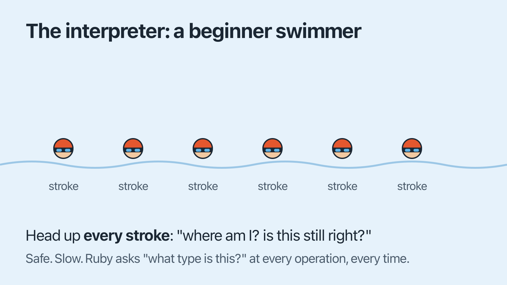
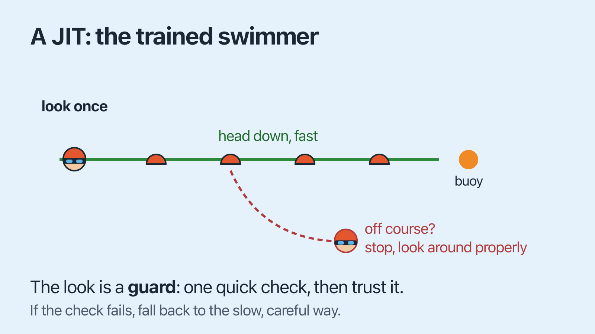
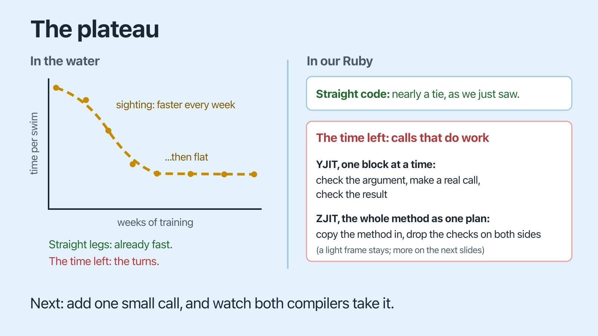
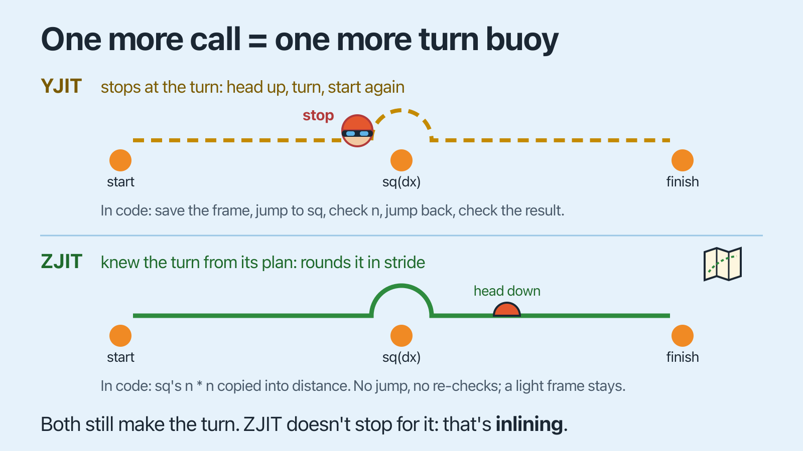
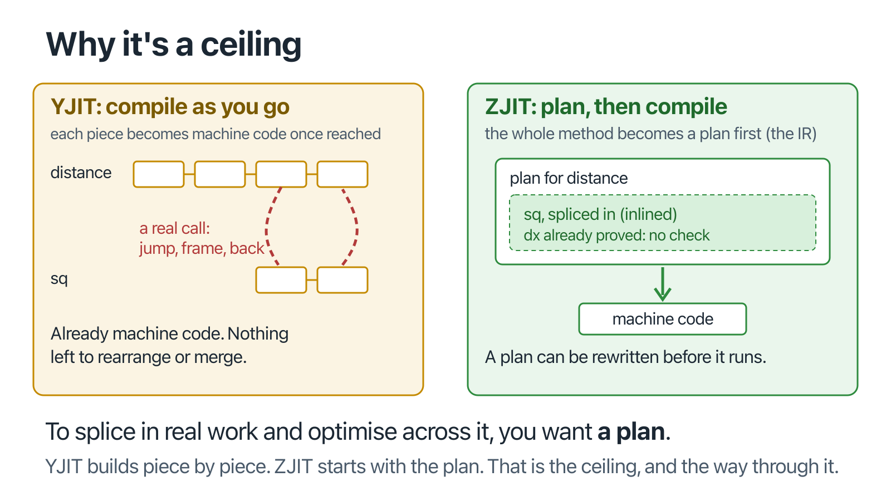
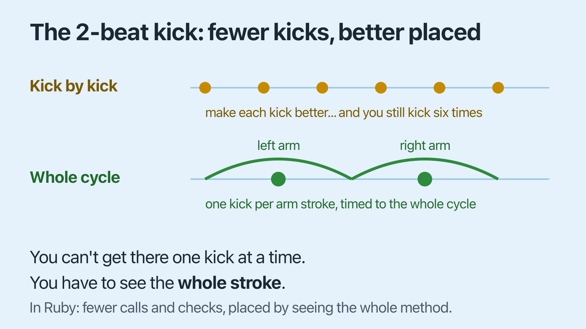
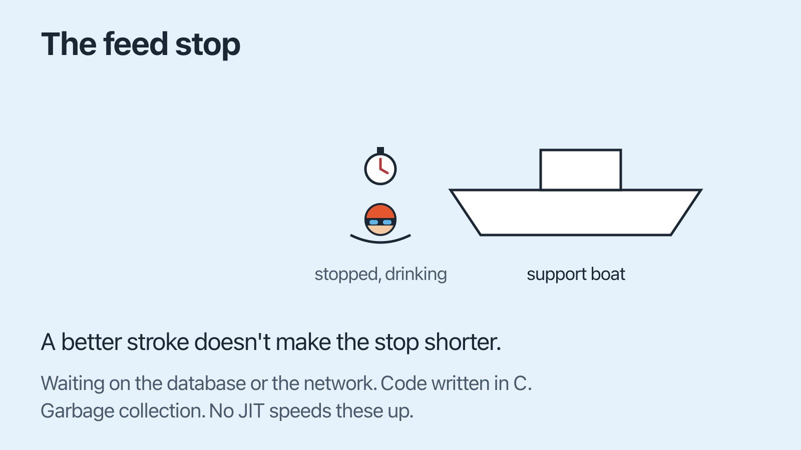

#+TITLE: The Ceiling: Why Ruby 4.0 Needed a Second Compiler
#+AUTHOR: Dhruva Sagar
#+DATE: RubyConf 2026
#+OPTIONS: toc:nil num:nil timestamp:nil reveal_width:1600 reveal_height:900
#+STARTUP: overview
#+PROPERTY: header-args :eval never-export :exports code
#+PROPERTY: header-args:sh :dir (progn (defvar ceiling--tangling nil) (unless ceiling--tangling (let ((ceiling--tangling t)) (save-excursion (org-babel-tangle)))) "../src") :results output verbatim :prologue "export PATH=\"$HOME/.asdf/shims:$PATH\""
#+PROPERTY: header-args:ruby :dir (progn (defvar ceiling--tangling nil) (unless ceiling--tangling (let ((ceiling--tangling t)) (save-excursion (org-babel-tangle)))) "../src") :noweb yes :results output :ruby "$HOME/.asdf/shims/ruby"

# How this file works
# - Each top-level heading is a slide; :DURATION: is its time budget.
#   Speaker notes are in #+begin_notes (reveal speaker view: press "s").
# - Ruby on the slides lives in NAMED blocks. The Demo section assembles
#   them with noweb and tangles them into ../src/, so the code on a slide
#   IS the code that ran. Never edit ../src/ by hand.
# - Any sh/ruby block re-tangles before it runs (the :dir expression), and
#   runs in ../src/ under the Ruby pinned in ../.tool-versions, via asdf's
#   shims (Emacs's own PATH doesn't matter). Nothing runs on export.
# - Every listing on a slide is cut from ../captures/ (made by
#   ../bin/capture) and is checked line by line by ../bin/check. The
#   comment "# capture: FILE" above a listing names its source.

#+REVEAL_ROOT: https://cdn.jsdelivr.net/npm/reveal.js@4.6.1
#+REVEAL_VERSION: 4
#+REVEAL_PLUGINS: (highlight notes search zoom)
#+REVEAL_HIGHLIGHT_CSS: https://cdnjs.cloudflare.com/ajax/libs/highlight.js/11.9.0/styles/atom-one-dark.min.css
#+REVEAL_THEME: white
#+REVEAL_TRANS: none
#+REVEAL_MARGIN: 0.04
#+REVEAL_INIT_OPTIONS: slideNumber: true, hash: true
#+REVEAL_HEAD_PREAMBLE: 
#+REVEAL_TITLE_SLIDE: <h1>%t</h1>
%a · %d

Ruby 4.0 ships two JIT compilers. Why build the second one?

* Timing plan                                                      :noexport:

The per-slide timing, estimates and the end-to-end script are generated
into [[file:narration.org][narration.org]] by =bin/narration= from the
speaker notes below. Change the notes or a =:DURATION:=, then run it.

The spine is technical: one method through both compilers, a tie, then
one extra call that only one of them can see through, and why. Swimming
is texture: long-distance swimming is about efficiency, not power, and so
is a JIT.

Cut order if long: (1) "The 2-beat kick" (say its one line on the quote
slide); (2) "YJIT: in its own words". Never cut "On five lines, nearly a tie", "At
the turn buoy" or "Why it's a ceiling": they are the argument.

* Every time you lift your head
:PROPERTIES:
:DURATION: 1:15
:END:

/"Every time you lift your head, you slow down."/

Ruby 4.0 ships *two* just-in-time compilers: *YJIT*, speeding up Rails apps for years, and *ZJIT*, "the next generation of YJIT".

We'll follow one five-line method, and one tiny refactor of it, through both.

#+begin_notes
[STORY: learning long-distance open water. Suggested shape: "When I started
swimming long distance I tried to go faster by pulling harder. I burned
out. My coach said: every time you lift your head, you slow down. Long
distance isn't about power. It's about not wasting any."]

That turns out to be how compilers make Ruby fast too: not by doing each
step harder, but by wasting less.

Ruby 4.0 came out last Christmas with two just-in-time compilers. YJIT has
made real Rails apps faster for years. ZJIT is new: Ruby's release notes call it "the next
generation of YJIT". Most of us will upgrade without ever looking at
what changed.

So why build a second one? We'll follow one five-line method, and one
tiny refactor of it, through both. By the end you'll see the exact line
where one compiler has to stop and the other doesn't. And next time someone says "Ruby is slow",
you'll have a better question to ask.

[Bio, one line: fifteen years of Ruby; I write Rust, which both are
written in.]
#+end_notes

* Ruby swims with its head up
:PROPERTIES:
:DURATION: 0:15
:REVEAL_EXTRA_ATTR: class="diagram"
:END:

#+attr_html: :alt The beginner swimmer lifts their head every stroke

#+begin_notes
A beginner lifts their head every stroke: where am I, is this still right?
Safe, and slow.

Ruby's interpreter runs your code a lot like that. Let me show you.
#+end_notes

* Our five lines
:PROPERTIES:
:DURATION: 0:30
:END:

#+name: point-class
#+begin_src ruby
class Point
  attr_reader :x, :y
  def initialize(x, y) = (@x, @y = x, y)
end
#+end_src

#+name: distance-v1
#+begin_src ruby
def distance(a, b)
  dx = a.x - b.x
  dy = a.y - b.y
  Math.sqrt(dx * dx + dy * dy)
end
#+end_src

#+attr_html: :class cap
The method we'll follow all talk.

#+begin_notes
Here's the method we'll follow all talk: the distance between two points.

Before any JIT touches it, Ruby turns it into bytecode, and the
interpreter runs that.
#+end_notes

* The bytecode
:PROPERTIES:
:DURATION: 1:15
:END:

# LIVE: C-c C-c on stage. Instant, the same every run. Fallback below.
#+begin_src sh
ruby -r ./distance -e 'puts RubyVM::InstructionSequence.of(method(:distance)).disasm'
#+end_src

#+attr_html: :class cap
What the interpreter actually runs. Steps =0000=-=0010= are the first line, =dx = a.x - b.x=.

# capture: yarv-distance.txt
#+begin_example
0000 getlocal_WC_0          a@0
0002 opt_send_without_block <calldata!mid:x, argc:0, ARGS_SIMPLE>
0004 getlocal_WC_0          b@1
0006 opt_send_without_block <calldata!mid:x, argc:0, ARGS_SIMPLE>
0008 opt_minus              <calldata!mid:-, argc:1, ARGS_SIMPLE>
0010 setlocal_WC_0          dx@2
 ...
0022 setlocal_WC_0          dy@3
 ...
0038 opt_plus               <calldata!mid:+, argc:1, ARGS_SIMPLE>
0040 opt_send_without_block <calldata!mid:sqrt, argc:1, ARGS_SIMPLE>
0042 leave
#+end_example
#+begin_export html
<ol class="ann-notes">
<li data-l="1">get <code>a</code></li>
<li data-l="2">call <code>x</code> on it: <code>a.x</code></li>
<li data-l="3">get <code>b</code></li>
<li data-l="4"><code>b.x</code></li>
<li data-l="5">minus: whole numbers? checked every time</li>
<li data-l="6">store it in <code>dx</code></li>
<li data-l="8">the same six steps for <code>dy</code></li>
<li data-l="10"><code>dx * dx + dy * dy</code></li>
<li data-l="11"><code>Math.sqrt(...)</code></li>
<li data-l="12">return</li>
</ol>
#+end_export

#+attr_html: :class cap
Every step is general, and checks as it goes, every time it runs: the interpreter with its head up. Remember =0002= and the minus.

#+attr_html: :class ver
Ruby 4.1.0-preview1

#+begin_notes
[Run the live block.]

This is what the interpreter actually runs. Get a, call x on it. Get b,
call x on it. Minus. Store it in dx.

That minus doesn't know it's subtracting numbers. It could be anything
with a minus method. There's a fast path for whole numbers, but it has to
check first, every single time: the interpreter lifting its head.

Remember step 0002, a.x, and that minus. We'll see both again. You can run
this line on your own code tonight.

[If asked about the rest: it's a stack machine; calldata says which method
and how many arguments. See the Q&A doc.]
#+end_notes

* Learning to sight
:PROPERTIES:
:DURATION: 1:00
:REVEAL_EXTRA_ATTR: class="diagram"
:END:

#+attr_html: :alt A trained swimmer looks once, then keeps their head down

#+begin_notes
[STORY, one or two lines: learning to sight. You still have to look, or
you swim the wrong way. The skill is looking less, and only when it
counts.]

A just-in-time compiler does that for your busiest code: one quick check
per stretch, a guard, "is this still a number?", then fast machine code.
If it fails: YJIT compiles another version; ZJIT hands back to the
interpreter.

Ruby has two. YJIT decides one block at a time, as it swims. ZJIT watches
first, then plans the whole method.
#+end_notes

* YJIT: compile as you go
:PROPERTIES:
:DURATION: 0:15
:END:

- Once a method is called often (warm), compile *a block*, a few instructions, and run it
- Look at the values that really turned up
- Compile the next block for exactly those

#+attr_html: :class cap
/In the water: sighting as you swim, deciding stretch by stretch./

#+begin_notes
YJIT compiles as it goes. Once a method is warm, it compiles a few
instructions, a block, runs them, looks at what really turned up, then compiles the
next few for exactly that. Sighting as you swim.

[Depth: lazy basic block versioning.]
#+end_notes

* YJIT: in its own words
:PROPERTIES:
:DURATION: 1:00
:END:

#+attr_html: :class cap
YJIT's dump, trimmed: its comments (=#=), and the arm64 machine code it wrote under each.

# capture: yjit-distance.txt
#+begin_example
# Block: distance@distance.rb:7
# Insn: 0002 opt_send_without_block (stack_size: 1)
# call to Point#x
# guard not immediate
0x16bbc4120: tst x1, #7
0x16bbc4124: b.ne #0x16bbc6284
 ...
# guard known class
0x16bbc4150: cmp x11, x12
0x16bbc4154: b.ne #0x16bbc62fc
# guard shape
0x16bbc416c: cmp w12, w13
0x16bbc4170: b.ne #0x16bbc6378
0x16bbc4178: ldur x1, [x11, #0x10]
 ...
# Block: distance@distance.rb:7
# Insn: 0004 getlocal_WC_0 (stack_size: 1)
# defer_compilation
0x16bbc417c: b #0x16bbc63b4
#+end_example
#+begin_export html
<ol class="ann-notes">
<li data-l="1">a block: a stretch of compiled code</li>
<li data-l="2">step <code>0002</code> from the bytecode: <code>a.x</code></li>
<li data-l="3"><code>Point#x</code> is an <code>attr_reader</code>: no Ruby code to run</li>
<li data-l="4">guard (a check) 1: an object, not a packed small value (<code>42</code>, <code>:x</code>, <code>nil</code>)?</li>
<li data-l="5">test the low 3 bits (7 = <code>0b111</code>)</li>
<li data-l="6">any set? back to YJIT</li>
<li data-l="8">guard 2: is its class <code>Point</code>?</li>
<li data-l="9">its class pointer vs <code>Point</code>'s address</li>
<li data-l="10">different? back to YJIT</li>
<li data-l="11">guard 3: is <code>@x</code> where it was last time?</li>
<li data-l="12">its shape (instance-variable layout) vs the one seen before</li>
<li data-l="13">different? back to YJIT</li>
<li data-l="14">all three guards passed: load <code>@x</code>, 16 bytes into the object. No call</li>
<li data-l="16">the next block</li>
<li data-l="17">step <code>0004</code>: get <code>b</code></li>
<li data-l="18">not compiled yet, so:</li>
<li data-l="19">back to YJIT: compile it the first time we get here</li>
</ol>
#+end_export

#+attr_html: :class cap
A failed guard goes back to YJIT: it compiles another version of the block for what it found (up to 4), then hands over to the interpreter.

#+attr_html: :class ver
Ruby 4.1.0-preview1 · =ruby --yjit --yjit-dump-disasm=

#+begin_notes
This is YJIT's dump. The lines with a hash are its comments; under each is
the machine code it wrote, for this Mac's arm64 chip.

Insn 0002: that's step 0002 from the bytecode, a.x. YJIT sees it's a
call to Point#x, an attribute reader. Then three guards, three checks: a real object, a Point, laid out as before.
Each is two instructions: compare, and if it's wrong, go back to YJIT. All
three pass, and one load reads @x straight out of the object. No call.

Then a new block, and defer_compilation: just a jump back to YJIT. The
first time the code gets there, YJIT compiles the next block, for whatever b
really is.

[Depth: each b.ne jumps to a branch stub, a placeholder that calls YJIT:
if a guard fails, YJIT compiles
another version for what it found, up to a limit (four by default). "Shape"
is an object's instance-variable layout. Trimmed: register moves and YJIT's
housekeeping between these lines.]
#+end_notes

* ZJIT: watch, then plan
:PROPERTIES:
:DURATION: 0:30
:END:

- While the interpreter runs the method, record which types turn up: a *profile*
- Then turn the *whole method* into a plan: the *IR* (intermediate representation)
- Improve the plan, then compile it, once

#+attr_html: :class cap
/In the water: watch a few laps, then plan the whole course, turns included./

#+begin_notes
ZJIT does it the other way round. While the interpreter runs your method,
it keeps notes on which types showed up. That's a profile.

Then it turns the whole method into a plan, its intermediate
representation, improves the plan, and compiles it in one go. Like
watching a few laps, then planning the whole course.
#+end_notes

* ZJIT: in its own words
:PROPERTIES:
:DURATION: 1:00
:END:

#+attr_html: :class cap
ZJIT's own dump, trimmed: its *IR* (intermediate representation), the plan for the whole method. Each line: =name:type = operation inputs=.

# capture: zjit-distance.txt
#+begin_example
fn distance@distance.rb:7:
bb3(v15:BasicObject, v16:BasicObject, v17:BasicObject):
  v79:ObjectSubclass[class_exact:Point] = GuardType v16
  v82:CShape[0x10007a] = GuardBitEquals v81, CShape(0x10007a)
  v83:BasicObject = LoadField v79, :@x
  ...
  v93:Fixnum = GuardType v83, Fixnum
  v94:Fixnum = GuardType v90, Fixnum
  v95:Fixnum = FixnumSub v93, v94
  ...
  v118:Fixnum = FixnumMult v95, v95
  ...
  v130:BasicObject = CCallWithFrame v54, :Math.sqrt, v126
  Return v130
#+end_example
#+begin_export html
<ol class="ann-notes">
<li data-l="1">the whole <code>distance</code> method, compiled at once</li>
<li data-l="2">block <code>bb3</code>, the body. Inputs: <code>self</code> (<code>v15</code>), <code>a</code> (<code>v16</code>), <code>b</code> (<code>v17</code>)</li>
<li data-l="3">guard: is <code>a</code>'s class exactly <code>Point</code>? YJIT's guards 1 and 2 in one step</li>
<li data-l="4">guard: is its shape (<code>v81</code>) <code>0x10007a</code>? YJIT's guard 3, same number</li>
<li data-l="5">load <code>@x</code> from <code>a</code> (now <code>v79</code>): <code>v83</code> is <code>a.x</code>. No call</li>
<li data-l="7">guard: is <code>a.x</code> a Fixnum (a packed small integer)?</li>
<li data-l="8">and <code>b.x</code>? (<code>v90</code>, read the same way)</li>
<li data-l="9">the minus, inputs already guarded: <code>dx</code> is <code>v95</code>, set once</li>
<li data-l="11"><code>dx * dx</code>: <code>v95</code> is already a Fixnum, no guard</li>
<li data-l="13">call <code>Math.sqrt</code> in C (<code>v54</code> is <code>Math</code>) on <code>v126</code>: <code>dx*dx + dy*dy</code></li>
<li data-l="14">return the result</li>
</ol>
#+end_export

#+attr_html: :class cap
Each value is named once (=v95= is =dx=). A failed guard exits to the interpreter; ZJIT can recompile later.

#+attr_html: :class ver
Ruby 4.1.0-preview1 · =ruby --zjit --zjit-dump-hir=

#+begin_notes
This is ZJIT's plan for our five lines: its IR, intermediate
representation. The whole method fits on one slide, and the right-hand
side tells you how to read it.

Read one line and you can read them all. "v95, colon, Fixnum, equals,
FixnumSub v93, v94": a name, its type, then the operation and its inputs.

Every value gets a name, set exactly once. v16 is a. GuardType: is it a
Point? GuardBitEquals: is its shape the one we saw? The same guards YJIT
made, but if one fails here, ZJIT goes back to the interpreter.

Remember the minus from the bytecode? Here it's FixnumSub, after two
GuardTypes, and it makes dx, v95. Then dx times dx: FixnumMult v95, v95.
CCallWithFrame calls into C for Math.sqrt.

[Depth: "set once" is SSA. Trimmed: PatchPoints, which discard this code
if someone redefines Point#x.]
#+end_notes

* On five lines, nearly a tie
:PROPERTIES:
:DURATION: 0:45
:END:

# capture: yjit-distance.txt, zjit-distance.txt
#+begin_example
YJIT                                      ZJIT
# Insn: 0008 opt_minus (stack_size: 2)
# guard arg0 fixnum                       v93:Fixnum = GuardType v83, Fixnum
# guard arg1 fixnum                       v94:Fixnum = GuardType v90, Fixnum
0x16bbc41f4: subs x11, x1, x14            v95:Fixnum = FixnumSub v93, v94
 ...                                      ...
# call to Point#y                         v102:BasicObject = LoadField v79, :@y
# guard known class
# guard shape
 ...                                      ...
# Insn: 0030 opt_mult (stack_size: 3)
0x16bbc42f4: mul x11, x11, x12            v118:Fixnum = FixnumMult v95, v95
#+end_example

#+attr_html: :class cap
Same checks at the minus; neither re-checks =dx= at =dx * dx=. At =a.y=, YJIT checks =a= again; ZJIT already knows it. 15 checks vs 8, each one cheap.

#+attr_html: :class ver
Ruby 4.1.0-preview1 · default settings

#+begin_notes
So who wins on our five lines? Honestly: nearly a tie.

At the minus, both check: two guards each, then the same subtract. At dx
times dx, neither checks again: both already know dx is a Fixnum.

The one difference is a.y. YJIT checks a's class and shape again; ZJIT
checked them once, for a.x, and reuses that. Over the whole method, YJIT
makes 15 checks and ZJIT 8. Each is a compare and a jump, so: close.

On straight-line code like this one, YJIT already gets the wins. To see why
ZJIT exists, we need something every Ruby codebase is full of.
#+end_notes

* The plateau
:PROPERTIES:
:DURATION: 1:15
:REVEAL_EXTRA_ATTR: class="diagram"
:END:

#+attr_html: :alt Swim times flatten once straight legs are fast; in Ruby the time left is at method calls, which ZJIT can copy in

#+begin_notes
[STORY: the plateau. Suggested: "Sighting made me faster every week. Then
it stopped. When I looked at where the time went, the straight legs were
fine. I was losing it at the turns." Keep only what's true for you.]

Ruby's plateau looks the same. Straight code is nearly the tie we just saw: YJIT
already got those wins. What's left is at the turns, and in Ruby a turn is
a method call. We write small methods calling small
methods.

YJIT folds in trivial calls, like that attribute reader. But at a call
to a method that does work, it checks, calls, checks again. ZJIT can copy
the small method in and drop those checks.

Let's add one turn to our five lines, and watch both compilers take it.
#+end_notes

* One more call
:PROPERTIES:
:DURATION: 0:30
:END:

#+name: distance-v2
#+begin_src ruby
def sq(n) = n * n

def distance(a, b)
  dx = a.x - b.x
  dy = a.y - b.y
  Math.sqrt(sq(dx) + sq(dy))
end
#+end_src

#+attr_html: :class cap
The smallest refactor: =n * n= pulled out into =sq=. One more call.

#+begin_notes
The smallest refactor you'd ever make: pull n times n into a helper
called sq.
#+end_notes

* One more call is one more buoy
:PROPERTIES:
:DURATION: 0:30
:REVEAL_EXTRA_ATTR: class="diagram"
:END:

#+attr_html: :alt One more call is one more turn buoy

#+begin_notes
Both swimmers still go round the buoy: sq's multiply still happens.
YJIT stops at it: head up, turn, start again. That's a real call.
ZJIT planned the course, so it rounds the buoy in stride: sq is copied
into distance. That's called inlining.
#+end_notes

* At the turn buoy
:PROPERTIES:
:DURATION: 1:15
:END:

# capture: yjit-sq.txt, zjit-sq.txt
#+begin_example
YJIT                                     ZJIT
# call to Object#sq                      PushInlineFrame :sq, v116, num_args=1
# push callee control frame
# gen_direct_jmp: existing block
 ...
# Block: sq@distance_sq.rb:6
# Insn: 0004 opt_mult (stack_size: 2)    v169:Fixnum = FixnumMult v95, v95
# guard arg0 fixnum
# guard arg1 fixnum
# pop stack frame                        PopInlineFrame
 ...                                     ...
# Insn: 0036 opt_plus (stack_size: 3)    v125:Fixnum = FixnumAdd v169, v173
# guard arg0 fixnum
#+end_example

#+attr_html: :class cap
YJIT: a real call (push a frame, jump, pop, return). =sq= serves every caller, so it checks =n=; at =+= it checks again. ZJIT: =sq= copied in, a light frame stays. No jump, no check on =n=, none at =+=.

#+attr_html: :class ver
Ruby 4.1.0-preview1 · default settings

#+begin_notes
The stop on the left, the stride on the right.

YJIT compiles sq as its own code, so distance has to call it. A call
means a frame: Ruby's bookkeeping for one method call, the line you'd see
in a backtrace. Set it up, jump, run, tear down, jump back. All that to
multiply two numbers. Since that sq serves every caller, it checks n. And when it
returns, YJIT doesn't know what came back, so at the plus it checks again.

ZJIT, right. sq is spliced in: no jump, no check on n. It still sets up a
light frame, in case it ever has to hand back to the interpreter. And
because it saw inside sq, it knows the result is a number: the plus has no
check at all.

[Fair to YJIT, if asked: force it to compile early and it carries "n is a
number" into sq, so no check there. Its team says its design "allows for
easy interprocedural type-based specialization". The call stays. Also if
asked: ZJIT's inline frame is real (stack check, save SP, push frame); it
is cheaper than a call, not free.]
#+end_notes

* Why it's a ceiling
:PROPERTIES:
:DURATION: 1:00
:REVEAL_EXTRA_ATTR: class="diagram"
:END:

#+attr_html: :alt Taking out a call means changing both sides at once; YJIT's blocks are already machine code, ZJIT's whole-method plan is still open to change

#+begin_notes
So why can't YJIT just do the same? Taking out a call means changing
both sides at once. The caller, the method, and the
checks between them.

YJIT writes machine code as it goes. By the time it reaches the call,
distance is already machine code, and sq was compiled on its own. No plan
left to change, so the call stays.

ZJIT plans the whole method first. Both sides are in the plan, still open
to change: copy sq in, drop the checks, then write machine code.

So better blocks can't get you there. YJIT's limit is what it sees at
once: one block. A design limit, not YJIT standing still. That's the
ceiling, and ZJIT raises it by compiling, in the team's words, one entire
method at a time.

If that sounds abstract: I hit the same ceiling in the water.

[If asked "doesn't YJIT have an IR?": yes, a low-level one inside its code
generator (yjit/src/backend/ir.rs). What it doesn't build is a plan of a
whole method.]

[Sources: Bernstein, Rails at Scale, 2025-05-14: "Instead of compiling one
basic block at a time, it compiles one entire method at a time"; "gives
more code at once to the optimizer".]
#+end_notes

* The 2-beat kick
:PROPERTIES:
:DURATION: 0:30
:REVEAL_EXTRA_ATTR: class="diagram"
:END:

#+attr_html: :alt Improving one kick at a time keeps all six; seeing the whole stroke lets you drop four. YJIT improves each block and the call stays; ZJIT sees the whole method and drops it

#+begin_notes
[STORY: your 2-beat kick, in your own words. The lines below are its
bones; keep only what's true for you.]

The goal is the same speed for less effort. I kicked six times a stroke
and made each kick stronger: still six kicks of effort. Only when I looked
at the kicks against my arms, the whole stroke, could I drop four.

Same for compilers. YJIT makes each block faster; the call between blocks
stays. ZJIT sees the whole method, so it can drop the call. The ZJIT team's
word for that is the compilation unit.
#+end_notes

* So, why build the second one?
:PROPERTIES:
:DURATION: 1:00
:END:

1. The next gains need the *whole method as one plan*. A compiler that works block by block never has one.
2. A more traditional compiler, so *more people can help build it*.

#+begin_quote
"we want to both raise the performance ceiling (bigger compilation unit size and SSA IR) and encourage more outside contribution (by becoming a more traditional method compiler)."
--- Max Bernstein, ZJIT team, Rails at Scale, 2025-12-24
#+end_quote

#+begin_export html
<table class="legend" style="margin:6px auto 0;font-size:0.5em">
<tr><td><b>compilation unit</b></td><td>how much is compiled at once: for ZJIT, a whole method</td></tr>
<tr><td><b>SSA IR</b></td><td>the plan ZJIT showed us: an intermediate representation in <i>static single-assignment</i> form, where every value gets one name, set once</td></tr>
<tr><td><b>method compiler</b></td><td>compiles one method at a time: the textbook shape</td></tr>
</table>

Source: <a href="https://railsatscale.com/2025-12-24-launch-zjit/">railsatscale.com/2025-12-24-launch-zjit</a>

#+end_export

#+begin_notes
Back to the question I started with: why build a second one?

Because the next gains, like seeing through that call, need the whole
method as one plan, and a compiler that works block by block never has
one. And a traditional compiler is a shape many compiler engineers
already know, so more people can help build it. In their words:

[Read the quote.] The three terms are underneath: a compilation unit is
how much gets compiled at once; SSA IR is the plan we saw, every value
named once.

[If asked about the cost: ZJIT plans from what it saw while warming up. If
traffic changes after that, it hands back to the interpreter and
recompiles. See the Q&A doc.]

[Sources: launch post 2025-12-24 ("if your method call patterns change
significantly after your code has been compiled, we will frequently
side-exit into the interpreter"); merge post 2025-05-14 ("a more
traditional “textbook” compiler so it is easy for the community to
contribute to").]
#+end_notes

* Race day: params
:PROPERTIES:
:DURATION: 0:30
:END:

# capture: hwia-source.txt
#+begin_example
def 
  super(convert_key(key))
end

def convert_key(key)
  Symbol === key ? key.name : key
end
#+end_example

#+attr_html: :class cap
=HashWithIndifferentAccess=: what Rails =params= is built on. =[]= calls =convert_key=: a small method calling a small method.

#+attr_html: :class ver
activesupport 8.1.4.1

#+begin_notes
Toy methods flatter compilers. Here's one you run right now:
HashWithIndifferentAccess, which Rails params are built on. Look up a key:
turn a symbol into a string, then a normal hash lookup. And look: a small
method calling a small method.
#+end_notes

* params, through both
:PROPERTIES:
:DURATION: 0:45
:END:

#+attr_html: :class cap
YJIT at =[]=: stops at the turn, a real call to =convert_key=

# capture: hwia-yjit-disasm.txt
#+begin_example
# call to ActiveSupport::HashWithIndifferentAccess#convert_key
# push callee control frame
# gen_direct_jmp: existing block
#+end_example
#+begin_export html
<ol class="ann-notes">
<li data-l="1">a real call to <code>convert_key</code>, like <code>sq</code></li>
<li data-l="2">set up its frame</li>
<li data-l="3">jump to its code</li>
</ol>
#+end_export

#+attr_html: :class cap
ZJIT at =[]=: takes it in stride, =convert_key= copied in

# capture: hwia-zjit-hir.txt
#+begin_example
PushInlineFrame :convert_key, v27, num_args=1
v78:BoolExact = IsA v10, v43
CondBranch v50, bb8(), bb7()
 ...
PopInlineFrame
v35:BasicObject = CCallWithFrame v27, :Hash#[], v71
#+end_example
#+begin_export html
<ol class="ann-notes">
<li data-l="1"><code>convert_key</code> copied in</li>
<li data-l="2"><code>Symbol === key</code>: a plain type test</li>
<li data-l="3">Symbol? take <code>key.name</code>; else keep <code>key</code></li>
<li data-l="5">end of the copy</li>
<li data-l="6"><code>Hash#[]</code> in C: both compilers call it</li>
</ol>
#+end_export

#+attr_html: :class ver
Ruby 4.1.0-preview1 · default settings

#+begin_notes
The same turn buoy, on a real course.

YJIT makes a real call into convert_key, just like sq.

ZJIT splices convert_key in. "Symbol triple-equals key" becomes a plain
type test and a branch. Then both compilers call Hash#[], which is written
in C.

[Depth: where the caller passes a literal like :id, ZJIT inlines [] and
convert_key into it and folds "Symbol === :id" away entirely.]
#+end_notes

* The feed stop
:PROPERTIES:
:DURATION: 0:30
:REVEAL_EXTRA_ATTR: class="diagram"
:END:

#+attr_html: :alt A feed stop: a better stroke doesn't make it shorter

#+begin_notes
And that's the feed stop. Hashing the key and finding it happens in C, and
no Ruby compiler speeds up the C itself. Same for waiting on the database, and for
garbage collection. A JIT speeds up the swim, not the stop at the boat.
#+end_notes

* A glimpse: seven everyday lines
:PROPERTIES:
:DURATION: 0:30
:END:

#+attr_html: :class cap
Each line in its own method, called 100,000 times, default settings. Counting calls into Ruby methods: calls into C happen under both.

# glimpse: rows generated from captures/glimpse-*.txt by bin/lib/glimpse.rb; bin/check verifies them
| One line | YJIT: real calls into Ruby methods | ZJIT: inlined into one plan |
|----------+------------------------------------+-----------------------------|
| =params[:name].present?= | 4 calls | all 4 inlined |
| =name.presence= | 3 calls | all 3 inlined |
| =text.squish= | 2 calls | both inlined |
| =list.second= | 1 call | 1 inlined |
| =5.minutes= | 3 calls | 2 inlined, 1 call |
| =obj.try(:upcase)= | 1 call | 1 call (not inlined) |
| =nil.blank?= | inlined | folded to a constant |

#+attr_html: :class cap
Fewer jumps and fewer checks, not free: ZJIT still sets up a light frame for each. We counted calls; we didn't time them.

#+attr_html: :class ver
activesupport 8.1.4.1 · Ruby 4.1.0-preview1 · default settings

#+begin_notes
params isn't a one-off. Seven lines you'll find in any Rails app.

Five of them: YJIT makes real calls, ZJIT turns them into one plan. But
read the bottom too. 5.minutes still calls initialize. try isn't inlined
at all. And nil.blank? YJIT inlines that one as well.

And as it says at the bottom: inlined isn't free.
#+end_notes

* Calm water, choppy water
:PROPERTIES:
:DURATION: 1:15
:END:

#+begin_src ruby :eval never
def double(x) = x + x   # called with Integers only, or with five types
#+end_src

#+attr_html: :class cap
Calm water, only Integers: ZJIT copies =double= in, one check, one add. Choppy water, five types at the same spot. ZJIT plans for all five:

# capture: zjit-choppy.txt
#+begin_example
PushInlineFrame :double, v23, num_args=1
CondBranchHasType v10, ArrayExact, bb8(), bb9()
v72:BasicObject = CCallWithFrame v37, :Array#+, v10
 ...
CondBranchHasType v10, Fixnum, bb12(), bb13()
v79:BasicObject = CCallWithFrame v47, :Integer#+, v10
 ...
v60:BasicObject = Send v10, :+, v10
#+end_example
#+begin_export html
<ol class="ann-notes">
<li data-l="1"><code>double</code> copied in: no call</li>
<li data-l="2">check: an Array?</li>
<li data-l="3">yes: call Array's <code>+</code> directly</li>
<li data-l="4">the same for Rational</li>
<li data-l="5">a whole number?</li>
<li data-l="6">yes: a call into C, where calm water had one add</li>
<li data-l="7">the same for Float and String</li>
<li data-l="8">none of the five: a general call</li>
</ol>
#+end_export

#+attr_html: :class cap
YJIT, same chop: a real call to =double=, then a version per type inside it. Whole numbers keep the fast inline add; the other four call C.

#+attr_html: :class ver
Ruby 4.1.0-preview1 · default settings

#+begin_notes
Now the honest part: chop.

Calm water, only whole numbers: ZJIT copies double in, one check, one
add.

Choppy: five types through the same line. ZJIT plans for all five. It
checks the type, one after another, and calls that type's plus directly.
Anything else gets a general call. But look at whole numbers: calm water
got one add; here, a call into C.

YJIT still makes a real call to double, but inside it keeps a version per
type, and whole numbers still get the fast add.

In chop, both look up at every wave. ZJIT still takes the turn in stride,
but swims every wave the careful way. YJIT stops at the turn, but keeps
its fast stroke for the common wave. We didn't time which matters more.

[Depth: neither handed back to the interpreter, 0 side exits each
(captures zjit-choppy-stats, yjit-choppy-stats).]
#+end_notes

* Measured: the ZJIT team's results, and ours
:PROPERTIES:
:DURATION: 0:45
:END:

| What                                      | YJIT    | ZJIT    | Source                      |
|-------------------------------------------+---------+---------+-----------------------------|
| Writing instance variables, per run       | 5 ms    | 2 ms    | ZJIT team, Mar 2026          |
| JIT memory, Shopify storefront            | 125 MiB | 101 MiB | ZJIT team, Oct 2026          |
| Ruby calls in =params[:name].present?=    | 4       | 0       | ours                        |
| Machine code for our =params= program     | 320 KiB | 352 KiB | ours                        |
| Hand-backs to the interpreter, choppy water | 0       | 0       | ours                        |

#+attr_html: :class cap
The team, Oct 2026: ZJIT is "probably as fast as or faster than YJIT" on Shopify's storefront, and "there are definitely some where we are worse". Ours are counts and sizes from this talk's captures, not timings.

#+begin_export html

Sources: <a href="https://railsatscale.com/2026-03-18-how-zjit-removes-redundant-object-loads-and-stores/">Denbeaux, Rails at Scale, 2026-03-18</a> · <a href="https://railsatscale.com/2026-10-09-zjit-is-now-as-fast-as-yjit/">Bernstein, Rails at Scale, 2026-10-09</a> · ours: captures/ in the repo

#+end_export

#+begin_notes
Don't take my word for it. Here's what the ZJIT team has measured, next to
what we've seen today.

Theirs: writing instance variables, ZJIT is over twice as fast, from an
optimization across the whole method. On Shopify's storefront it uses less
memory, and is probably as fast or faster, with some places worse.

Ours are counts, not timings. ZJIT generated a bit more machine code,
which the team says too. Different measures: their memory is the whole JIT
on a big app; ours is the machine code for one small program.

[Depth: team, Oct 2026: "we generate more code (less precise than LBBV and
more versions) and probably bigger code". Sizes are each compiler's
reported code region (code_region_size / code_region_bytes), captures
hwia-yjit-stats and hwia-zjit-stats.]
#+end_notes

* Read your own code
:PROPERTIES:
:DURATION: 0:30
:END:

#+begin_src sh :eval never
ruby -r ./your_file -e 'puts RubyVM::InstructionSequence.of(method(:m)).disasm'
ruby --zjit --zjit-dump-hir   your_file.rb
ruby --zjit --zjit-stats      your_file.rb
#+end_src

Look for:
1. A call that's still a call: a turn you could make easier
2. Checks you didn't expect: a value that isn't one type
3. Calls into C: time mostly out of the compiler's reach

#+begin_notes
Three commands: the bytecode, ZJIT's plan, ZJIT's statistics.

In the plan, look for three things. Calls that are still calls. Checks on
values you thought were always one type. And calls into C, where the time
is out of the compiler's reach.
#+end_notes

* What it means for Ruby
:PROPERTIES:
:DURATION: 0:30
:END:

YJIT compiles Ruby a bit at a time, deciding as it goes; ZJIT plans a
whole method at once, so it can see through small method calls and pay
less for them. That's the ceiling the ZJIT team set out to raise.

- For you: small, clear methods are exactly what inlining is for
- Ruby 4.1, in a few weeks: try =--zjit=

#+begin_notes
[Read the slide.]

For you: small, clear methods are exactly what inlining is for. The 4.1
notes list "method inlining" for small Ruby methods.

The 4.0 release notes set the goal "faster than YJIT and production-ready
in Ruby 4.1". The 4.1 notes
say it can still be slower on larger apps. 4.1 ships in a few weeks. Try
it with --zjit.

[Sources: Ruby 4.0.0 release notes, 2025-12-25; Ruby 4.1 NEWS.]
#+end_notes

* Head down
:PROPERTIES:
:DURATION: 0:45
:END:

/"Every time you lift your head, you slow down."/

Next time someone says "Ruby is slow", ask: *which part?*

Slides, code, every capture, the full write-up: [[https://github.com/dhruvasagar/the-ceiling][github.com/dhruvasagar/the-ceiling]]

#+begin_notes
[STORY: the closing swim. A recent swim or race where it came together:
efficient, sighting only when it counted, through the turns without
stopping. Two or three sentences.]

Ruby is learning the same thing: waste less, look up only when it counts,
and take the turns in stride.

Next time someone says "Ruby is slow", ask "which part?" Often it's the
turns, and that's what the second compiler was built for. Thank you.
#+end_notes

* Sources
:PROPERTIES:
:DURATION: 0:00
:END:

#+begin_export html

<b>The ZJIT team, Rails at Scale</b>

<ul style="list-style:none;margin:0 0 18px;padding:0;display:block">
<li style="margin-bottom:10px;line-height:1.3"><a href="https://railsatscale.com/2025-05-14-merge-zjit/">ZJIT has been merged into Ruby</a> Bernstein, 2025-05-14</li>
<li style="margin-bottom:10px;line-height:1.3"><a href="https://railsatscale.com/2025-12-24-launch-zjit/">ZJIT is now available in Ruby 4.0</a> Bernstein, 2025-12-24</li>
<li style="margin-bottom:10px;line-height:1.3"><a href="https://railsatscale.com/2026-03-18-how-zjit-removes-redundant-object-loads-and-stores/">How ZJIT removes redundant object loads and stores</a> Denbeaux, 2026-03-18</li>
<li style="margin-bottom:10px;line-height:1.3"><a href="https://railsatscale.com/2026-05-27-a-new-register-allocator-for-zjit/">A new register allocator for ZJIT</a> Patterson, 2026-05-27</li>
<li style="margin-bottom:10px;line-height:1.3"><a href="https://railsatscale.com/2026-07-28-the-inliner-is-yielding-benefits/">The inliner is yielding benefits for ZJIT</a> Bernstein, 2026-07-28</li>
<li style="margin-bottom:10px;line-height:1.3"><a href="https://railsatscale.com/2026-10-09-zjit-is-now-as-fast-as-yjit/">ZJIT is now as fast as YJIT</a> Bernstein, 2026-10-09</li>
</ul>

<b>Ruby</b>

<ul style="list-style:none;margin:0 0 18px;padding:0;display:block">
<li><a href="https://www.ruby-lang.org/en/news/2025/12/25/ruby-4-0-0-released/">Ruby 4.0.0 release notes</a></li>
<li><a href="https://github.com/ruby/ruby/blob/master/NEWS.md">Ruby 4.1 NEWS</a></li>
<li><a href="https://github.com/ruby/ruby/blob/master/doc/jit/zjit.md">ZJIT docs</a> · <a href="https://github.com/ruby/ruby/blob/master/doc/jit/yjit.md">YJIT docs</a></li>
</ul>

<b>YJIT research</b>

<ul style="list-style:none;margin:0 0 18px;padding:0;display:block">
<li><a href="https://arxiv.org/abs/1411.0352">Type check removal</a> ECOOP 2015</li>
<li><a href="https://doi.org/10.1145/3486606.3486781">YJIT</a> VMIL 2021</li>
<li><a href="https://doi.org/10.1145/3617651.3622982">YJIT in production</a> MPLR 2023</li>
</ul>

<b>Everything else</b>

<ul style="list-style:none;margin:0 0 18px;padding:0;display:block">
<li><a href="https://github.com/dhruvasagar/the-ceiling">github.com/dhruvasagar/the-ceiling</a></li>
<li>every capture, exact quotes, claims ledger</li>
</ul>

#+end_export

#+begin_notes
[Leave this up for questions.]
#+end_notes

* Demo                                                             :noexport:

** Files

The program behind the first half of the talk.

#+begin_src ruby :tangle ../src/distance.rb :mkdirp yes
<<point-class>>

<<distance-v1>>

<<warmup>>
#+end_src

The same program after the one-line refactor ("One more call").

#+begin_src ruby :tangle ../src/distance_sq.rb :mkdirp yes
<<point-class>>

<<distance-v2>>

<<warmup>>
#+end_src

Enough calls that both JITs compile =distance= at their default settings
(30 calls each); 1,000 clears that comfortably.

#+name: warmup
#+begin_src ruby :eval never
a = Point.new(3, 4)
b = Point.new(0, 0)
1_000.times { distance(a, b) }
#+end_src

"How each one compiles": call =distance= 40 times, saying which call we are
on, so each JIT's compile log lands next to the call that triggered it.
Default thresholds, nothing forced.

#+begin_src ruby :tangle ../src/distance_log.rb :mkdirp yes
<<point-class>>

<<distance-v1>>

$stdout.sync = true
a = Point.new(3, 4)
b = Point.new(0, 0)
1.upto(40) do |i|
  puts "call #{i}"
  distance(a, b)
end
#+end_src

"Where it gives up": the same tiny method, warmed up in calm water
(only Integers) or in chop (five different types from the first call).

#+name: double
#+begin_src ruby :eval never
def double(x) = x + x
#+end_src

#+begin_src ruby :tangle ../src/calm.rb :mkdirp yes
<<double>>

1_000.times { [1, 2, 3, 4, 5].each { double(_1) } }
#+end_src

#+begin_src ruby :tangle ../src/choppy.rb :mkdirp yes
<<double>>

1_000.times { [1, 2.5, "ab", [1], 3r].each { double(_1) } }
#+end_src

=params=-shaped traffic: string keys stored, asked for with both a Symbol
and a String, so =convert_key= sees two types.

#+begin_src ruby :tangle ../src/hwia.rb :mkdirp yes
require "active_support"
require "active_support/hash_with_indifferent_access"

params = ActiveSupport::HashWithIndifferentAccess.new("id" => 1, "name" => "x")
100_000.times do
  params[:id]
  params["name"]
end
#+end_src

"A glimpse": seven everyday ActiveSupport lines, each wrapped in a
one-line method and called 100,000 times, so both compilers compile it at
their default settings. bin/lib/glimpse.rb turns the two captures into the
slide's table.

#+begin_src ruby :tangle ../src/glimpse.rb :mkdirp yes
require "active_support"
require "active_support/hash_with_indifferent_access"
require "active_support/core_ext/object/blank"
require "active_support/core_ext/object/try"
require "active_support/core_ext/string/filters"
require "active_support/core_ext/array/access"
require "active_support/core_ext/numeric/time"

def g_params(params) = params[:name].present?
def g_presence(name) = name.presence
def g_squish(text) = text.squish
def g_second(list) = list.second
def g_minutes(n) = n.minutes
def g_try(obj) = obj.try(:upcase)
def g_nil_blank(value) = value.blank?

params = ActiveSupport::HashWithIndifferentAccess.new("name" => "dhruva")
100_000.times { g_params(params) }
100_000.times { g_presence("dhruva") }
100_000.times { g_squish("  hello   world  ") }
100_000.times { g_second([1, 2, 3]) }
100_000.times { g_minutes(5) }
100_000.times { g_try("dhruva") }
100_000.times { g_nil_blank(nil) }
#+end_src

Print the real source of the two methods on the HWIA slide, from the
installed gem.

#+begin_src ruby :tangle ../src/hwia_source.rb :mkdirp yes
require "active_support"
require "active_support/hash_with_indifferent_access"

hwia = ActiveSupport::HashWithIndifferentAccess
puts "activesupport #{ActiveSupport.version}"
%i[[] convert_key].each do |name|
  file, line = hwia.instance_method(name).source_location
  src = File.readlines(file)[(line - 1)..]
  puts "", "# #{File.basename(file)}:#{line}", src.take(src.index { _1 =~ /^\s*end\b/ } + 1)
end
#+end_src

** Captures

Each capture is one =bin/capture= target; it writes ../captures/NAME.txt
(paths and memory addresses scrubbed) and prints it. Re-run them all from a
shell with =bin/capture=, then =bin/check=.

#+name: cap-env
#+begin_src sh
../bin/capture env
#+end_src

#+name: cap-how
#+begin_src sh
../bin/capture how-yjit how-zjit >/dev/null
echo "YJIT compile events for distance: $(grep -c 'distance@' ../captures/how-yjit.txt)"
echo "ZJIT compile events for distance: $(grep -c 'distance@' ../captures/how-zjit.txt)"
#+end_src

#+name: cap-yjit-sq
#+begin_src sh
../bin/capture yjit-sq >/dev/null
grep -nE '# (call to Object#sq|Block: sq|guard arg|push callee|pop stack|clear local)' ../captures/yjit-sq.txt | head -20
#+end_src

#+name: cap-zjit-sq
#+begin_src sh
../bin/capture zjit-sq >/dev/null
awk '/^fn distance@/{p=1} p&&/^$/{exit} p' ../captures/zjit-sq.txt
#+end_src
