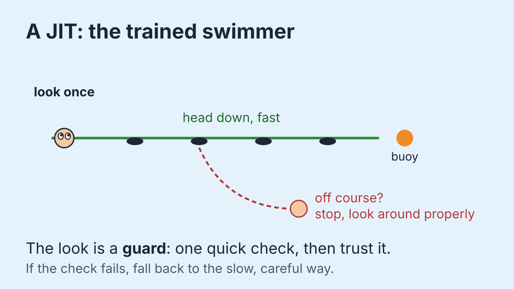
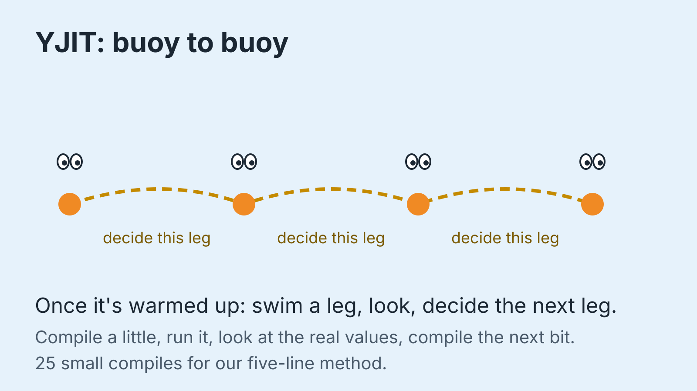
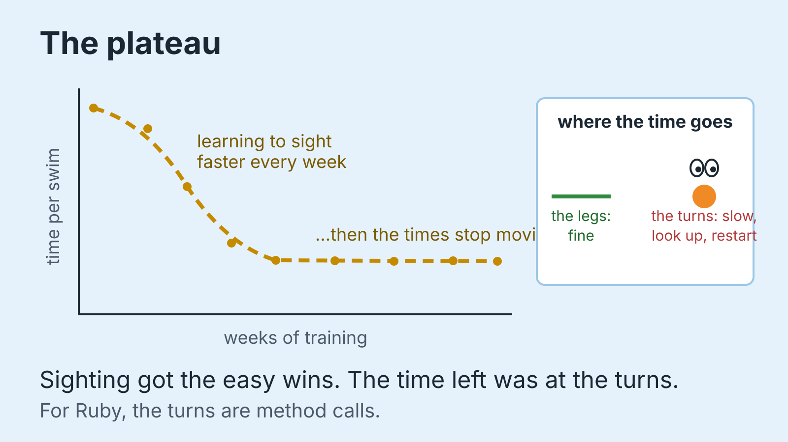
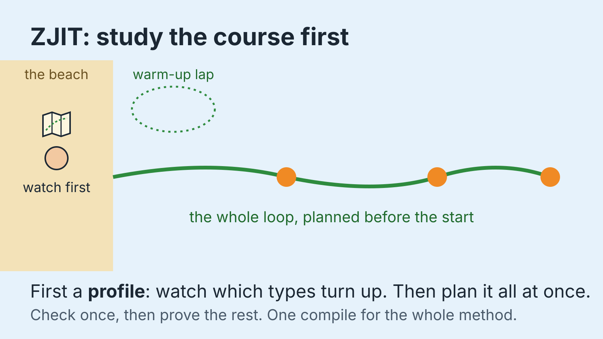

#+TITLE: The Ceiling: Why Ruby 4.0 Needed a Second Compiler
#+AUTHOR: Dhruva Sagar
#+DATE: RubyConf 2026
#+OPTIONS: toc:nil num:nil timestamp:nil reveal_width:1600 reveal_height:900
#+STARTUP: overview
#+PROPERTY: header-args :eval never-export :exports code
#+PROPERTY: header-args:sh :dir (progn (defvar ceiling--tangling nil) (unless ceiling--tangling (let ((ceiling--tangling t)) (save-excursion (org-babel-tangle)))) "../src") :results output verbatim :prologue "export PATH=\"$HOME/.asdf/shims:$PATH\""
#+PROPERTY: header-args:ruby :dir (progn (defvar ceiling--tangling nil) (unless ceiling--tangling (let ((ceiling--tangling t)) (save-excursion (org-babel-tangle)))) "../src") :noweb yes :results output :ruby "$HOME/.asdf/shims/ruby"

# How this file works
# - Each top-level heading is a slide; :DURATION: is its time budget.
#   Speaker notes are in #+begin_notes (reveal speaker view: press "s").
# - Ruby on the slides lives in NAMED blocks. The Demo section assembles
#   them with noweb and tangles them into ../src/, so the code on a slide
#   IS the code that ran. Never edit ../src/ by hand.
# - Any sh/ruby block re-tangles before it runs (the :dir expression), and
#   runs in ../src/ under the Ruby pinned in ../.tool-versions, via asdf's
#   shims (Emacs's own PATH doesn't matter). Nothing runs on export.
# - Every listing on a slide is cut from ../captures/ (made by
#   ../bin/capture) and is checked line by line by ../bin/check. The
#   comment "# capture: FILE" above a listing names its source.

#+REVEAL_ROOT: https://cdn.jsdelivr.net/npm/reveal.js@4.6.1
#+REVEAL_VERSION: 4
#+REVEAL_PLUGINS: (highlight notes search zoom)
#+REVEAL_HIGHLIGHT_CSS: https://cdnjs.cloudflare.com/ajax/libs/highlight.js/11.9.0/styles/atom-one-dark.min.css
#+REVEAL_THEME: white
#+REVEAL_TRANS: none
#+REVEAL_MARGIN: 0.04
#+REVEAL_INIT_OPTIONS: slideNumber: true, hash: true
#+REVEAL_HEAD_PREAMBLE: 
#+REVEAL_TITLE_SLIDE: <h1>%t</h1>
%a · %d

Ruby 4.0 ships two JIT compilers. Why build the second one?

* Timing plan                                                      :noexport:

The talk is one swimmer's journey, mine, and Ruby's journey alongside it.
Three stages of learning open water are the three ways Ruby runs code:

| Act              | My swim                                   | Ruby                        |
|------------------+-------------------------------------------+-----------------------------|
| 1. Head up       | first open-water swim; the coach's line   | the interpreter             |
| 2. Sighting      | faster every week                         | YJIT (Ruby 3.1)             |
| 3. The plateau   | times stop moving; the turns cost me      | YJIT's ceiling: calls       |
| 4. Whole stroke  | plan the line; the 2-beat kick            | ZJIT (Ruby 4.0); inlining   |
| 5. Race day      | feed stops; fog and chop                  | C code, waiting; polymorphic |
| 6. Back to coach | a recent swim where it all came together  | what it means for Ruby      |

| Slide                              | Budget | Act |
|------------------------------------+--------+-----|
| Every time you lift your head      |   1:15 |   1 |
| Ruby swims with its head up        |   0:30 |   1 |
| Our five lines                     |   0:30 |   1 |
| The bytecode                       |   0:45 |   1 |
| Learning to sight                  |   1:00 |   2 |
| YJIT: buoy to buoy                 |   0:45 |   2 |
| YJIT, in its own words             |   1:00 |   2 |
| The plateau                        |   1:15 |   3 |
| ZJIT: study the course             |   0:45 |   4 |
| ZJIT: the IR on one slide          |   1:15 |   4 |
| 25 compiles, or one                |   0:45 |   4 |
| One more call                      |   0:30 |   4 |
| One more call is one more buoy     |   0:30 |   4 |
| At the turn buoy                   |   1:30 |   4 |
| The 2-beat kick                    |   1:00 |   4 |
| In the ZJIT team's words           |   0:45 |   4 |
| Race day: a method you already run |   1:15 |   5 |
| The feed stop                      |   0:30 |   5 |
| Fog and chop                       |   0:30 |   5 |
| Calm water, choppy water           |   0:45 |   5 |
| What it means for Ruby             |   1:00 |   6 |
| Head down                          |   0:45 |   6 |
|------------------------------------+--------+-----|
| total                              |  18:45 |     |

1:15 of slack. Cut order if long: (1) "YJIT, in its own words" to its first
six lines; (2) "Fog and chop" (go straight to calm vs choppy). Never cut
"The plateau", "At the turn buoy" or "The 2-beat kick": they are the
story.

The [STORY: …] lines are mine to fill, in my own words. Everything in
square brackets in the notes is stage direction or depth-if-asked, not
spoken.

* Every time you lift your head
:PROPERTIES:
:DURATION: 1:15
:END:

/"Every time you lift your head, you slow down."/

Ruby 4.0 ships *two* just-in-time compilers. Why build the second one?

#+begin_notes
[STORY: your first open-water swim. Suggested shape: "The first time I swam
in open water, I lifted my head every few strokes to see where I was. I
came out exhausted, nowhere near the buoy. My coach said one thing: every
time you lift your head, you slow down."]

That sentence turned out to be about Ruby too.

Ruby 4.0 came out last Christmas with two just-in-time compilers. YJIT you
may already run. It's made real Rails apps faster for years. ZJIT is new,
from the same team.

So why would a team with a working, successful compiler build a second
one? I'm going to answer that with my own swimming, and with one
five-line method.

[Bio, one line: fifteen years of Ruby, and I write Rust, which both
compilers are written in.]
#+end_notes

* Ruby swims with its head up
:PROPERTIES:
:DURATION: 0:30
:REVEAL_EXTRA_ATTR: class="diagram"
:END:

#+attr_html: :alt The beginner swimmer lifts their head every stroke
[[file:img/head-up.svg]]

#+begin_notes
This was me that first day. Head up every stroke: where am I, is this
still right? Safe. Slow.

And this is how Ruby's interpreter runs your code. Let me show you.
#+end_notes

* Our five lines
:PROPERTIES:
:DURATION: 0:30
:END:

#+name: point-class
#+begin_src ruby
class Point
  attr_reader :x, :y
  def initialize(x, y) = (@x, @y = x, y)
end
#+end_src

#+name: distance-v1
#+begin_src ruby
def distance(a, b)
  dx = a.x - b.x
  dy = a.y - b.y
  Math.sqrt(dx * dx + dy * dy)
end
#+end_src

#+begin_notes
Here's the method we'll follow all talk: the distance between two points.
Five lines.

Before any JIT touches it, Ruby turns it into bytecode and its interpreter
runs that.
#+end_notes

* The bytecode
:PROPERTIES:
:DURATION: 0:45
:END:

# LIVE: C-c C-c on stage. Instant, the same every run. Fallback below.
#+begin_src sh
ruby -r ./distance -e 'puts RubyVM::InstructionSequence.of(method(:distance)).disasm'
#+end_src

# capture: yarv-distance.txt
#+begin_example
0000 getlocal_WC_0          a@0
0002 opt_send_without_block <calldata!mid:x, argc:0, ARGS_SIMPLE>
0004 getlocal_WC_0          b@1
0006 opt_send_without_block <calldata!mid:x, argc:0, ARGS_SIMPLE>
0008 opt_minus              <calldata!mid:-, argc:1, ARGS_SIMPLE>
0010 setlocal_WC_0          dx@2
 ...
0040 opt_send_without_block <calldata!mid:sqrt, argc:1, ARGS_SIMPLE>
0042 leave
#+end_example

#+attr_html: :class ver
Ruby 4.1.0-preview1

#+begin_notes
[Run the live block.]

Read it top to bottom. Get a, call x on it. Get b, call x on it. Minus.
Store it in dx.

That "minus" doesn't know it's subtracting numbers. It could be anything
with a minus method. So every time it runs, the interpreter lifts its head
and checks. Try this line on your own code tonight.
#+end_notes

* Learning to sight
:PROPERTIES:
:DURATION: 1:00
:REVEAL_EXTRA_ATTR: class="diagram"
:END:

#+attr_html: :alt A trained swimmer looks once, then keeps their head down

#+begin_notes
[STORY: learning to sight. Suggested: "The first thing that made me faster
was learning to sight: look up once, find the buoy, head down, trust my
line."]

That's what a just-in-time compiler does. While your program runs, it
turns your busiest Ruby into machine code that checks once, then runs
fast.

That one quick check is called a guard. "Is this still a number?" If yes,
head down and go. If not, stop and look around properly: go back to the
slow, careful interpreter.

Ruby's first JIT to do this well was YJIT.
#+end_notes

* YJIT: buoy to buoy
:PROPERTIES:
:DURATION: 0:45
:REVEAL_EXTRA_ATTR: class="diagram"
:END:

#+attr_html: :alt YJIT swims buoy to buoy

#+begin_notes
YJIT swims buoy to buoy. Once your method is warm, it compiles a small
piece, lets it run, looks at the real values that turned up, and compiles
the next piece for exactly those.

Very little wasted work: it only compiles what runs, for the types that
really appear. It's why YJIT paid off so quickly.

[Depth: lazy basic block versioning, from Maxime Chevalier-Boisvert's
research. A basic block is a straight run of instructions.]
#+end_notes

* YJIT, in its own words
:PROPERTIES:
:DURATION: 1:00
:END:

# capture: yjit-distance.txt
#+begin_example
# Block: distance@distance.rb:7
# Insn: 0002 opt_send_without_block (stack_size: 1)
# call to Point#x
# guard not immediate
# guard known class
# guard shape
# Block: distance@distance.rb:7
# Insn: 0004 getlocal_WC_0 (stack_size: 1)
# defer_compilation
 ...
# Insn: 0008 opt_minus (stack_size: 2)
# guard arg0 fixnum
# guard arg1 fixnum
#+end_example

#+attr_html: :class cap
Each =Block= is a leg. Each =guard= is a sight. =defer_compilation= is the next buoy: "decide when I get there".

#+attr_html: :class ver
Ruby 4.1.0-preview1 · =ruby --yjit --yjit-dump-disasm=

#+begin_notes
This is YJIT describing its own work, with the machine code taken out.

At a.x it sights three times: is a an object, is it a Point, is it laid
out the way I saw last time? Then it reads @x directly.

"defer_compilation" is the buoy: YJIT doesn't decide what b is yet. It
lets the code run, looks, then compiles the next leg.

At the minus: two guards, both whole numbers. Leg by leg.

[Depth: "shape" is an object's instance-variable layout. "fixnum" is a
small integer that fits in a machine word.]
#+end_notes

* The plateau
:PROPERTIES:
:DURATION: 1:15
:REVEAL_EXTRA_ATTR: class="diagram"
:END:

#+attr_html: :alt Swim times drop fast while learning to sight, then stop moving

#+begin_notes
[STORY: the plateau. Suggested: "For a while every swim was faster. Then it
stopped. Sighting well, stroke feeling good, and my times didn't move."]

[STORY: the diagnosis. Suggested: "When I looked at where the time went,
the straight legs were fine. I was losing it at the buoys: slowing down,
looking up, starting my stroke again." Keep only what's true for you.]

Ruby hit the same wall. Sighting leg by leg got the big, easy wins. What's
left is at the turns, and in Ruby, the turns are method calls. We write
lots of small methods calling small methods. That's how we're taught.

To get past that, you have to see the turns before you reach them.
#+end_notes

* ZJIT: study the course
:PROPERTIES:
:DURATION: 0:45
:REVEAL_EXTRA_ATTR: class="diagram"
:END:

#+attr_html: :alt ZJIT studies the course before swimming

#+begin_notes
That's ZJIT. It studies the course first.

It lets the interpreter run your method a few times and keeps notes: at
each step, which types actually showed up. That's a profile, its warm-up
lap.

Then it compiles the whole method at once, turns included. Both compilers
still check. But with the whole method in view, ZJIT can prove more after
each check, and skip the checks that follow.
#+end_notes

* ZJIT: the IR on one slide
:PROPERTIES:
:DURATION: 1:15
:END:

# capture: zjit-distance.txt
#+begin_example
fn distance@distance.rb:7:
bb3(v15:BasicObject, v16:BasicObject, v17:BasicObject):
  v79:ObjectSubclass[class_exact:Point] = GuardType v16
  v82:CShape[0x10007a] = GuardBitEquals v81, CShape(0x10007a) recompile
  v83:BasicObject = LoadField v79, :@x
  ...
  v93:Fixnum = GuardType v83, Fixnum recompile
  v94:Fixnum = GuardType v90, Fixnum
  v95:Fixnum = FixnumSub v93, v94
  ...
  v118:Fixnum = FixnumMult v95, v95
  ...
  v130:BasicObject = CCallWithFrame v54, :Math.sqrt, v126
  Return v130
#+end_example

#+attr_html: :class cap
The whole method, planned at once. =GuardType= and =GuardBitEquals= are sights. =v95= is =dx=: proved a number once, then used with no more type checks.

#+attr_html: :class ver
Ruby 4.1.0-preview1 · =ruby --zjit --zjit-dump-hir=

#+begin_notes
This is ZJIT's plan for our five lines: its intermediate representation,
IR. The whole method fits on one slide.

Every value gets a name, and each name is set once. v16 is a.

GuardType: is a exactly a Point? GuardBitEquals: is it laid out as
expected? The same sights YJIT made. Then LoadField reads @x.

FixnumSub makes dx, named v95. Further down, dx times dx is FixnumMult
v95, v95: no type check in front of it, because v95 can only ever be what
ZJIT made it.

And CCallWithFrame: a call into C for Math.sqrt. No Ruby compiler can see
inside C. Remember that for later.

[Depth: "set once" is SSA, static single assignment. "recompile": if the
guard fails, ZJIT can recompile with better information. Trimmed here:
PatchPoints, which throw the code away if someone redefines Point#x.]
#+end_notes

* 25 compiles, or one
:PROPERTIES:
:DURATION: 0:45
:END:

# capture: how-yjit.txt, how-zjit.txt
#+begin_example
YJIT                                          ZJIT
call 30                                       call 30
distance@distance_log.rb:7 (index: 0)         distance@distance_log.rb:7
distance@distance_log.rb:7 (index: 2)
 ...
distance@distance_log.rb:10 (index: 42)
#+end_example

#+attr_html: :class cap
Default settings, 40 calls. Both start at call 30. YJIT: *25* small compiles, leg by leg. ZJIT: *1*.

#+attr_html: :class ver
Ruby 4.1.0-preview1 · =--yjit-log= / =--zjit-log-compiled-iseqs=

#+begin_notes
You can count the difference. Same program, nothing tuned. Both wait
until call 30: neither starts sooner.

Then YJIT logs twenty-five compiles for this one method, one per leg,
buoy to buoy. ZJIT logs one. The whole course.
#+end_notes

* One more call
:PROPERTIES:
:DURATION: 0:30
:END:

#+name: distance-v2
#+begin_src ruby
def sq(n) = n * n

def distance(a, b)
  dx = a.x - b.x
  dy = a.y - b.y
  Math.sqrt(sq(dx) + sq(dy))
end
#+end_src

#+begin_notes
Now let's add a turn. The smallest refactor you'd ever make: pull n times
n into a helper called sq. Tidy. We do this without thinking.
#+end_notes

* One more call is one more buoy
:PROPERTIES:
:DURATION: 0:30
:REVEAL_EXTRA_ATTR: class="diagram"
:END:

#+attr_html: :alt One more call is one more turn buoy
[[file:img/turn-buoy.svg]]

#+begin_notes
YJIT reaches the turn and lifts its head: sq is another method, so it
calls it, and sq checks its argument for itself.

ZJIT planned the turn on the beach. It splices sq straight into distance.
That's called inlining.
#+end_notes

* At the turn buoy
:PROPERTIES:
:DURATION: 1:30
:END:

# capture: yjit-sq.txt, zjit-sq.txt
#+begin_example
YJIT                                     ZJIT
# call to Object#sq                      v95:Fixnum = FixnumSub v93, v94
# push callee control frame              ...
# gen_direct_jmp: existing block         PushInlineFrame :sq, v116, num_args=1
 ...                                     v169:Fixnum = FixnumMult v95, v95
# Block: sq@distance_sq.rb:6             PopInlineFrame
# Insn: 0004 opt_mult (stack_size: 2)
# guard arg0 fixnum
# guard arg1 fixnum
# pop stack frame
#+end_example

#+attr_html: :class cap
YJIT: a real call into a general =sq=, which checks =n= again. ZJIT: a =sq= built for this spot, =v95= reused, no call, no check.

#+attr_html: :class ver
Ruby 4.1.0-preview1 · default settings

#+begin_notes
Here's the turn, in each compiler's own words.

YJIT, left. sq gets called twice as often as distance, so it warmed up
first, and YJIT compiled it on its own, for any caller. So distance makes
a real call: a new stack frame, a jump into that existing sq. And because
that sq has to work for anyone, it checks: is n a number? Then it pops the
frame and comes back.

ZJIT, right. PushInlineFrame is just a note that sq is "on the stack". Then
FixnumMult v95, v95: dx times dx, using dx's own name. No call. No check.

YJIT calls a sq built for everyone. ZJIT builds a sq for this spot.

[Fair to YJIT: its team says its design "allows for easy interprocedural
type-based specialization" (Rails at Scale, 2025-05-14). Force YJIT to
compile early and it does carry the type into sq. The call stays.]
#+end_notes

* The 2-beat kick
:PROPERTIES:
:DURATION: 1:00
:REVEAL_EXTRA_ATTR: class="diagram"
:END:

#+attr_html: :alt The 2-beat kick is timed to the whole stroke
[[file:img/two-beat-kick.svg]]

#+begin_notes
[STORY: the breakthrough. Suggested: "What finally made me faster wasn't
any single stroke. I planned my line through the turns, and I learned the
2-beat kick: two kicks per stroke cycle, timed to the whole stroke. I
couldn't get there one kick at a time."]

That's why ZJIT exists. YJIT tunes each piece, and it's brilliant at it.
The next gains need the whole method in view: you saw one at the turn
buoy. And that's not just my reading.
#+end_notes

* In the ZJIT team's words
:PROPERTIES:
:DURATION: 0:45
:END:

#+begin_quote
"we want to both raise the performance ceiling (bigger compilation unit size and SSA IR) and encourage more outside contribution (by becoming a more traditional method compiler)."
--- Max Bernstein, ZJIT team, Rails at Scale, 2025-12-24
#+end_quote

#+begin_notes
Raise the ceiling: a bigger piece compiled at once. And a more
traditional compiler shape, so more people can help build it.

The cost: time on the beach. ZJIT watches before it compiles. And in 4.0
it was, in their words, "faster than the interpreter, but not yet as fast
as YJIT. Yet."

[Sources: launch post 2025-12-24. Also: "a more traditional “textbook”
compiler so it is easy for the community to contribute to" (merge post,
2025-05-14).]
#+end_notes

* Race day: a method you already run
:PROPERTIES:
:DURATION: 1:15
:END:

# capture: hwia-source.txt
#+begin_example
def 
  super(convert_key(key))
end

def convert_key(key)
  Symbol === key ? key.name : key
end
#+end_example

# capture: hwia-zjit-stats.txt
#+begin_example
Top-20 calls to C functions from JIT code (99.3% of total 310,500):
Hash#[]: 199,971 (64.4%)
#+end_example

#+attr_html: :class cap
=HashWithIndifferentAccess=, what Rails =params= is built on. The thing its compiled code calls most is =Hash#[]=, written in C.

#+attr_html: :class ver
activesupport 8.1.4.1 · Ruby 4.1.0-preview1

#+begin_notes
Training is one thing. Race day is real code. Here's a method most of you
run right now: HashWithIndifferentAccess, which Rails params are built on.

Three lines of Ruby: turn a symbol key into a string, then do a normal
hash lookup.

Look at what ZJIT's compiled code spends its calls on: Hash#[], written
in C. Hashing the key, finding the slot. Whatever either compiler does
with the Ruby, that C code runs as it always did.
#+end_notes

* The feed stop
:PROPERTIES:
:DURATION: 0:30
:REVEAL_EXTRA_ATTR: class="diagram"
:END:

#+attr_html: :alt A feed stop: a better stroke doesn't make it shorter
[[file:img/feed-stop.svg]]

#+begin_notes
On a long swim that's the feed stop. A better stroke doesn't make the stop
at the boat any shorter. Waiting on the database, code in C, garbage
collection: no JIT speeds those up.
#+end_notes

* Fog and chop
:PROPERTIES:
:DURATION: 0:30
:REVEAL_EXTRA_ATTR: class="diagram"
:END:

#+attr_html: :alt Fog and chop: everyone swims head-up
[[file:img/fog-chop.svg]]

#+begin_notes
[STORY: chop. Suggested: "And in real chop, none of my training helped.
Everyone swims head-up."]

Ruby has chop too: a value that's a different type on every call. Here's
what that does.
#+end_notes

* Calm water, choppy water
:PROPERTIES:
:DURATION: 0:45
:END:

#+begin_src ruby :eval never
def double(x) = x + x
#+end_src

#+attr_html: :class cap
Calm: only Integers in the warm-up lap. Spliced in: one sight, one add.

# capture: zjit-calm.txt
#+begin_example
PushInlineFrame :double, v23, num_args=1
v44:Fixnum = GuardType v10, Fixnum recompile
v46:Fixnum = FixnumAdd v44, v44
PopInlineFrame
#+end_example

#+attr_html: :class cap
Choppy: five types. Five checks, five calls into C, then a general fallback.

# capture: zjit-choppy.txt
#+begin_example
PushInlineFrame :double, v23, num_args=1
CondBranchHasType v10, ArrayExact, bb8(), bb9()
v72:BasicObject = CCallWithFrame v37, :Array#+, v10
 ...
CondBranchHasType v10, Fixnum, bb12(), bb13()
v79:BasicObject = CCallWithFrame v47, :Integer#+, v10
 ...
Send v10, :+, v10 # SendFallbackReason: Send: polymorphic fallback
#+end_example

#+attr_html: :class ver
Ruby 4.1.0-preview1 · default settings · =ruby --zjit --zjit-dump-hir=

#+begin_notes
Same one-line method, two warm-up laps. Calm: one check, one add.

Chop: five types turned up. ZJIT plans for all of them, and every one is
now a call into C. Even plain integers: no single add any more. Nothing
crashed. The fast path is simply gone.

[Depth: neither JIT bailed out to the interpreter: 0 side exits for each
(captures zjit-choppy-stats, yjit-choppy-stats). YJIT compiles one version
per type instead.]
#+end_notes

* What it means for Ruby
:PROPERTIES:
:DURATION: 1:00
:END:

YJIT compiles Ruby a bit at a time, deciding as it goes; ZJIT plans a
whole method at once, so it can see through small method calls and stop
paying for them. That's the room Ruby needed to keep getting faster.

#+begin_src sh :eval never
ruby -r ./your_file -e 'puts RubyVM::InstructionSequence.of(method(:m)).disasm'
ruby --zjit --zjit-dump-hir   your_file.rb
ruby --zjit --zjit-stats      your_file.rb
#+end_src

#+begin_notes
So why did Ruby need a second compiler? The first one got the wins you
can get leg by leg. The next ones are at the turns, and our code is full
of turns.

For you: keep writing small, clear methods. The compiler is learning to
stop charging for them.

Where it stands, honestly: the 4.0 release notes set the goal "faster than
YJIT and production-ready in Ruby 4.1". In October the team wrote that ZJIT
is "probably as fast as or faster than YJIT" on Shopify's storefront. 4.1
ships in a few weeks. Try it with --zjit, and read what it does with your
code.

[Sources: Ruby 4.0.0 release notes, 2025-12-25; Rails at Scale,
2026-10-09, measured in "a couple small regions".]
#+end_notes

* Head down
:PROPERTIES:
:DURATION: 0:45
:END:

/"Every time you lift your head, you slow down."/

Next time someone says "Ruby is slow", ask: *which part?*

Slides, code, every capture, the full write-up: *[REPO-URL]*

#+begin_notes
[STORY: the closing swim. A recent swim or race where it came together:
where, how it felt, sighting rarely, swimming your line through the turns,
finishing strong. Two or three sentences.]

Every time you lift your head, you slow down. Ruby is learning to lift
its head less.

Next time someone says "Ruby is slow", ask "which part?", and now you can
show them. Thank you.
#+end_notes

* Demo                                                             :noexport:

** Files

The program behind the first half of the talk.

#+begin_src ruby :tangle ../src/distance.rb :mkdirp yes
<<point-class>>

<<distance-v1>>

<<warmup>>
#+end_src

The same program after the one-line refactor ("One more call").

#+begin_src ruby :tangle ../src/distance_sq.rb :mkdirp yes
<<point-class>>

<<distance-v2>>

<<warmup>>
#+end_src

Enough calls that both JITs compile =distance= at their default settings
(30 calls each); 1,000 clears that comfortably.

#+name: warmup
#+begin_src ruby :eval never
a = Point.new(3, 4)
b = Point.new(0, 0)
1_000.times { distance(a, b) }
#+end_src

"How each one compiles": call =distance= 40 times, saying which call we are
on, so each JIT's compile log lands next to the call that triggered it.
Default thresholds, nothing forced.

#+begin_src ruby :tangle ../src/distance_log.rb :mkdirp yes
<<point-class>>

<<distance-v1>>

$stdout.sync = true
a = Point.new(3, 4)
b = Point.new(0, 0)
1.upto(40) do |i|
  puts "call #{i}"
  distance(a, b)
end
#+end_src

"Where it gives up": the same tiny method, warmed up in calm water
(only Integers) or in chop (five different types from the first call).

#+name: double
#+begin_src ruby :eval never
def double(x) = x + x
#+end_src

#+begin_src ruby :tangle ../src/calm.rb :mkdirp yes
<<double>>

1_000.times { [1, 2, 3, 4, 5].each { double(_1) } }
#+end_src

#+begin_src ruby :tangle ../src/choppy.rb :mkdirp yes
<<double>>

1_000.times { [1, 2.5, "ab", [1], 3r].each { double(_1) } }
#+end_src

=params=-shaped traffic: string keys stored, asked for with both a Symbol
and a String, so =convert_key= sees two types.

#+begin_src ruby :tangle ../src/hwia.rb :mkdirp yes
require "active_support"
require "active_support/hash_with_indifferent_access"

params = ActiveSupport::HashWithIndifferentAccess.new("id" => 1, "name" => "x")
100_000.times do
  params[:id]
  params["name"]
end
#+end_src

Print the real source of the two methods on the HWIA slide, from the
installed gem.

#+begin_src ruby :tangle ../src/hwia_source.rb :mkdirp yes
require "active_support"
require "active_support/hash_with_indifferent_access"

hwia = ActiveSupport::HashWithIndifferentAccess
puts "activesupport #{ActiveSupport.version}"
%i[[] convert_key].each do |name|
  file, line = hwia.instance_method(name).source_location
  src = File.readlines(file)[(line - 1)..]
  puts "", "# #{File.basename(file)}:#{line}", src.take(src.index { _1 =~ /^\s*end\b/ } + 1)
end
#+end_src

** Captures

Each capture is one =bin/capture= target; it writes ../captures/NAME.txt
(paths and memory addresses scrubbed) and prints it. Re-run them all from a
shell with =bin/capture=, then =bin/check=.

#+name: cap-env
#+begin_src sh
../bin/capture env
#+end_src

#+name: cap-how
#+begin_src sh
../bin/capture how-yjit how-zjit >/dev/null
echo "YJIT compile events for distance: $(grep -c 'distance@' ../captures/how-yjit.txt)"
echo "ZJIT compile events for distance: $(grep -c 'distance@' ../captures/how-zjit.txt)"
#+end_src

#+name: cap-yjit-sq
#+begin_src sh
../bin/capture yjit-sq >/dev/null
grep -nE '# (call to Object#sq|Block: sq|guard arg|push callee|pop stack|clear local)' ../captures/yjit-sq.txt | head -20
#+end_src

#+name: cap-zjit-sq
#+begin_src sh
../bin/capture zjit-sq >/dev/null
awk '/^fn distance@/{p=1} p&&/^$/{exit} p' ../captures/zjit-sq.txt
#+end_src
