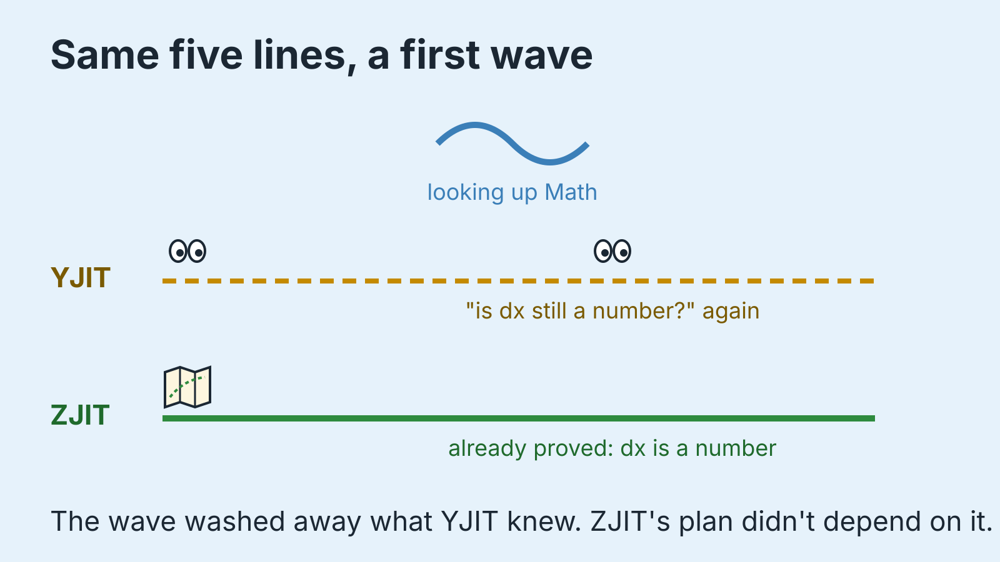
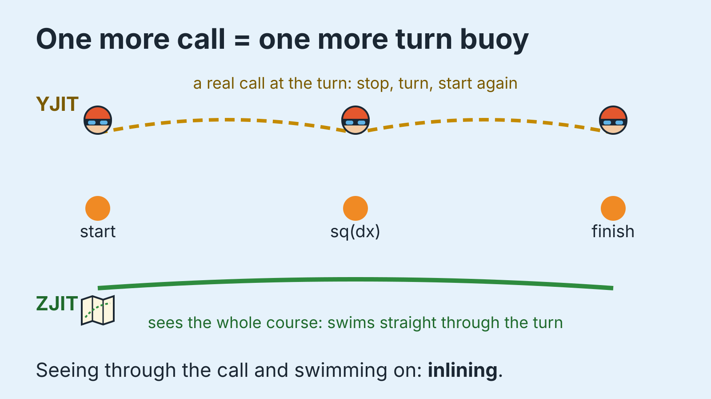
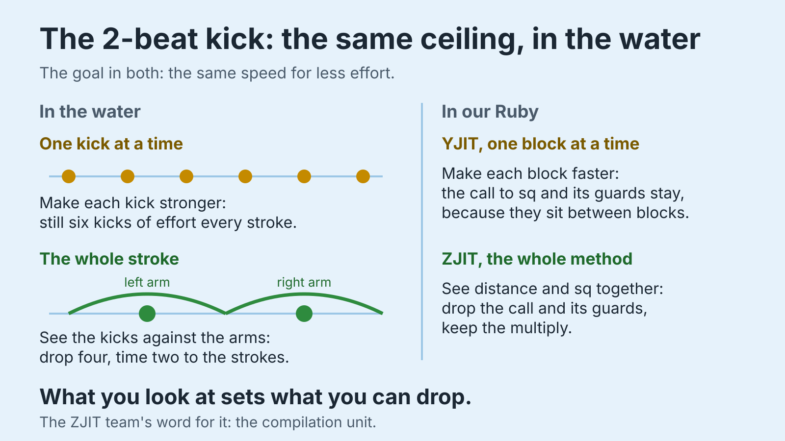
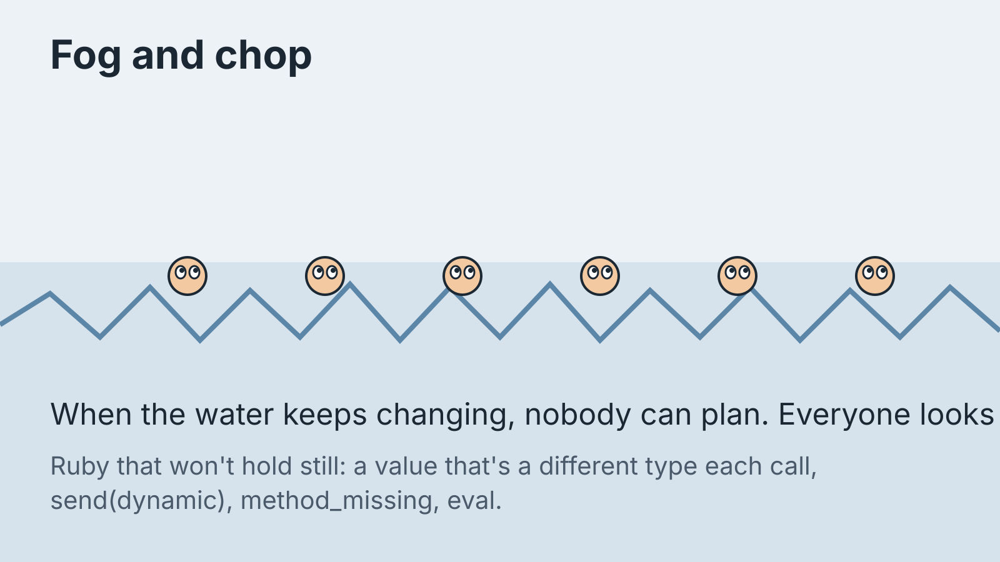

#+TITLE: The Ceiling: Why Ruby 4.0 Needed a Second Compiler
#+AUTHOR: Dhruva Sagar
#+DATE: RubyConf 2026
#+OPTIONS: toc:nil num:nil timestamp:nil reveal_width:1600 reveal_height:900
#+STARTUP: overview
#+PROPERTY: header-args :eval never-export :exports code
#+PROPERTY: header-args:sh :dir (progn (defvar ceiling--tangling nil) (unless ceiling--tangling (let ((ceiling--tangling t)) (save-excursion (org-babel-tangle)))) "../src") :results output verbatim :prologue "export PATH=\"$HOME/.asdf/shims:$PATH\""
#+PROPERTY: header-args:ruby :dir (progn (defvar ceiling--tangling nil) (unless ceiling--tangling (let ((ceiling--tangling t)) (save-excursion (org-babel-tangle)))) "../src") :noweb yes :results output :ruby "$HOME/.asdf/shims/ruby"

# How this file works
# - Each top-level heading is a slide; :DURATION: is its time budget.
#   Speaker notes are in #+begin_notes (reveal speaker view: press "s").
# - Ruby on the slides lives in NAMED blocks. The Demo section assembles
#   them with noweb and tangles them into ../src/, so the code on a slide
#   IS the code that ran. Never edit ../src/ by hand.
# - Any sh/ruby block re-tangles before it runs (the :dir expression), and
#   runs in ../src/ under the Ruby pinned in ../.tool-versions, via asdf's
#   shims (Emacs's own PATH doesn't matter). Nothing runs on export.
# - Every listing on a slide is cut from ../captures/ (made by
#   ../bin/capture) and is checked line by line by ../bin/check. The
#   comment "# capture: FILE" above a listing names its source.

#+REVEAL_ROOT: https://cdn.jsdelivr.net/npm/reveal.js@4.6.1
#+REVEAL_VERSION: 4
#+REVEAL_PLUGINS: (highlight notes search zoom)
#+REVEAL_HIGHLIGHT_CSS: https://cdnjs.cloudflare.com/ajax/libs/highlight.js/11.9.0/styles/atom-one-dark.min.css
#+REVEAL_THEME: white
#+REVEAL_TRANS: none
#+REVEAL_MARGIN: 0.04
#+REVEAL_INIT_OPTIONS: slideNumber: true, hash: true
#+REVEAL_HEAD_PREAMBLE: 
#+REVEAL_TITLE_SLIDE: <h1>%t</h1>
%a · %d

Ruby 4.0 ships two JIT compilers. Why build the second one?

* Timing plan                                                      :noexport:

| Slide                          | Budget | Promise from the abstract it keeps            |
|--------------------------------+--------+-----------------------------------------------|
| Two JITs. Why?                 |   1:00 | the question                                  |
| How Ruby runs your code        |   1:15 | "what Ruby's compiler produces" (bytecode)    |
| What a JIT does                |   1:00 | guard                                         |
| YJIT: buoy to buoy             |   1:15 | "YJIT watches which types turn up"            |
| YJIT, in its own words         |   1:15 | trace through YJIT                            |
| ZJIT: study the course         |   1:00 | "ZJIT takes a whole method at once"           |
| ZJIT: the IR on one slide      |   1:30 | "its IR on one slide"; "prove, not guess"     |
| 25 compiles, or one            |   1:00 | the difference, demonstrated                  |
| A first wave                   |   1:00 | where ZJIT wins (1)                           |
| One more call                  |   1:15 | where ZJIT wins (2)                           |
| At the turn buoy               |   1:45 | where ZJIT wins (2), shown                    |
| Why ZJIT was built             |   1:45 | the "why", in the team's words                |
| A method you already run       |   1:45 | "a hot method from a gem you've deployed"     |
| Where it gives up              |   1:15 | "where it gives up"; hot paths no JIT helps   |
| What it means for Ruby         |   1:00 | future + "read this for your own code"        |
| Which part is slow?            |   0:30 | close                                         |
|--------------------------------+--------+-----------------------------------------------|
| total                          |  19:30 | 30 s slack                                    |

Cut order if long: (1) "Where it gives up" to the feed stop only; (2)
"YJIT, in its own words" to its first block. Never cut "One more call",
"At the turn buoy" or "Why ZJIT was built".

* Two JITs. Why?
:PROPERTIES:
:DURATION: 1:00
:END:

Ruby 4.0 ships *two* just-in-time compilers.

YJIT already makes real Rails apps faster.

So why build a second one?

#+begin_notes
[STORY: your first open-water swim. Suggested: "The first time I swam in
open water, I lifted my head every few strokes to check where I was. I got
out exhausted and nowhere near the buoy. My coach said one thing: every
time you lift your head, you slow down."]

Hold onto that sentence. It's the whole talk.

Ruby 4.0 came out last Christmas with two just-in-time compilers in it.
YJIT you probably already run: Shopify built it, it's been in Ruby since
3.1, and it makes real Rails apps faster in production.

ZJIT is new, from the same team. In 4.0 it's still slower than YJIT. The
team's goal for 4.1, which ships a few weeks after this conference, is to
make it faster. So most of us are about to upgrade into it.

So why would a team with a working, successful compiler build a second
one? I'm not going to tell you. I'm going to show you, using one five-line
method and what each compiler actually produces for it.

[One line about you:] I've written Ruby for fifteen years, and I write
Rust, which is what both of these compilers are written in.
#+end_notes

* How Ruby runs your code
:PROPERTIES:
:DURATION: 0:30
:END:

#+name: point-class
#+begin_src ruby
class Point
  attr_reader :x, :y
  def initialize(x, y) = (@x, @y = x, y)
end
#+end_src

#+name: distance-v1
#+begin_src ruby
def distance(a, b)
  dx = a.x - b.x
  dy = a.y - b.y
  Math.sqrt(dx * dx + dy * dy)
end
#+end_src

#+begin_notes
Here's our method: the distance between two points with whole-number
coordinates.

Before any JIT touches it, Ruby turns it into bytecode and runs that in
its interpreter. Let me just print it.
#+end_notes

* The bytecode
:PROPERTIES:
:DURATION: 0:45
:END:

# LIVE: C-c C-c on stage. Instant, the same every run. Fallback below.
#+begin_src sh
ruby -r ./distance -e 'puts RubyVM::InstructionSequence.of(method(:distance)).disasm'
#+end_src

# capture: yarv-distance.txt
#+begin_example
0000 getlocal_WC_0          a@0
0002 opt_send_without_block <calldata!mid:x, argc:0, ARGS_SIMPLE>
0004 getlocal_WC_0          b@1
0006 opt_send_without_block <calldata!mid:x, argc:0, ARGS_SIMPLE>
0008 opt_minus              <calldata!mid:-, argc:1, ARGS_SIMPLE>
0010 setlocal_WC_0          dx@2
 ...
0040 opt_send_without_block <calldata!mid:sqrt, argc:1, ARGS_SIMPLE>
0042 leave
#+end_example

#+attr_html: :class ver
Ruby 4.1.0-preview1

#+begin_notes
[Run the live block.]

In irb that's one line, and I'd encourage you to try it on something of
yours tonight.

Read it top to bottom. Get a, call x on it. Get b, call x on it. Minus.
Store it in dx.

Here's the thing to notice: that "minus" doesn't know it's subtracting
numbers. It could be integers, decimals, or some object with its own minus
method. So every single time this runs, the interpreter checks.

[Show head-up diagram next.]
#+end_notes

* The interpreter: head up, every stroke
:PROPERTIES:
:DURATION: 0:00
:REVEAL_EXTRA_ATTR: class="diagram"
:END:

#+attr_html: :alt The beginner swimmer lifts their head every stroke
[[file:img/head-up.svg]]

#+begin_notes
That's the beginner swimmer. Head up every stroke: where am I, is this
still right? It's safe. It's also slow. [Timing: part of the previous
slide's 1:15.]
#+end_notes

* What a JIT does
:PROPERTIES:
:DURATION: 1:00
:REVEAL_EXTRA_ATTR: class="diagram"
:END:

#+attr_html: :alt A trained swimmer looks once, then keeps their head down
[[file:img/sighting.svg]]

#+begin_notes
A trained open-water swimmer sights. They look up once, check the buoy,
put their head down and trust their line for a while.

That's what a just-in-time compiler does. While your program runs, it
turns your hot Ruby into machine code that does the check once and then
runs fast.

That one quick check has a name: a guard. "Is this still a number?" If yes,
head down and go. If no, stop, look around properly: fall back to the
slow, careful interpreter.

Both of Ruby's JITs work this way. Where they differ is how they decide
what to check, and how much of the course they look at before they start.
#+end_notes

* YJIT: buoy to buoy
:PROPERTIES:
:DURATION: 1:15
:REVEAL_EXTRA_ATTR: class="diagram"
:END:

#+attr_html: :alt YJIT swims buoy to buoy
[[file:img/buoy-to-buoy.svg]]

#+begin_notes
YJIT swims buoy to buoy.

It doesn't plan the whole race. It compiles a small piece of your method,
lets it run, and when execution reaches the end of that piece, it looks at
the real values sitting there and compiles the next piece for exactly
those.

That's a really good design. There's very little wasted work: it only
compiles what actually runs, for the types that actually turn up. It's a
big part of why YJIT paid off so quickly.

[Depth, if asked: the technique is called lazy basic block versioning,
from Maxime Chevalier-Boisvert's research. A basic block is a straight run
of instructions with no branches. "Versioning": if a different type turns
up later, YJIT compiles another version of that piece.]
#+end_notes

* YJIT, in its own words
:PROPERTIES:
:DURATION: 1:15
:END:

# capture: yjit-distance.txt
#+begin_example
# Block: distance@distance.rb:7
# Insn: 0002 opt_send_without_block (stack_size: 1)
# call to Point#x
# guard not immediate
# guard known class
# guard shape
# Block: distance@distance.rb:7
# Insn: 0004 getlocal_WC_0 (stack_size: 1)
# defer_compilation
 ...
# Insn: 0008 opt_minus (stack_size: 2)
# guard arg0 fixnum
# guard arg1 fixnum
#+end_example

#+attr_html: :class cap
Each =Block= is one leg. =guard= is a sight. =defer_compilation= is the next buoy: "decide when I get there".

#+attr_html: :class ver
Ruby 4.1.0-preview1 · =ruby --yjit --yjit-dump-disasm=

#+begin_notes
This is YJIT's own commentary, printed next to the machine code it
generates. I've kept only its comments.

Look at a.x. Three guards: is a a real object, is its class Point, is its
layout the one I saw? Then, because x is a plain attr_reader, it doesn't
call anything: it just reads @x directly.

Then "defer_compilation". That's the buoy. YJIT doesn't guess what b is.
It stops compiling, lets the code run, and when it gets here for real, it
looks at b and compiles the next leg.

And at the minus: guard both sides are whole numbers. From here on, YJIT
knows dx is a number, and it carries that knowledge forward, leg to leg.

[Depth: "guard shape" checks the object's instance-variable layout,
called its shape. "fixnum" is Ruby's name for a small integer that fits
in a machine word.]
#+end_notes

* ZJIT: study the course
:PROPERTIES:
:DURATION: 1:00
:REVEAL_EXTRA_ATTR: class="diagram"
:END:

#+attr_html: :alt ZJIT studies the course before swimming
[[file:img/course-map.svg]]

#+begin_notes
ZJIT does it the other way round. It studies the course first.

It doesn't compile straight away. It lets the interpreter run the method a
number of times, and while that happens it keeps notes: at each step, which
types actually showed up. That's called a profile. Your warm-up lap.

Then it compiles the whole method in one go, with all of those notes in
hand. Not leg by leg: the whole loop, planned on the beach.

The brief for this talk said: YJIT guesses as it goes, ZJIT can prove
things. This is what that means. With the whole method in view, it can
work out what must be true, instead of checking again.
#+end_notes

* ZJIT: the IR on one slide
:PROPERTIES:
:DURATION: 1:30
:END:

# capture: zjit-distance.txt
#+begin_example
fn distance@distance.rb:7:
bb3(v15:BasicObject, v16:BasicObject, v17:BasicObject):
  v79:ObjectSubclass[class_exact:Point] = GuardType v16
  v83:BasicObject = LoadField v79, :@x
  v86:ObjectSubclass[class_exact:Point] = GuardType v17
  v90:BasicObject = LoadField v86, :@x
  v93:Fixnum = GuardType v83, Fixnum recompile
  v94:Fixnum = GuardType v90, Fixnum
  v95:Fixnum = FixnumSub v93, v94
  ...
  v118:Fixnum = FixnumMult v95, v95
  v122:Fixnum = FixnumMult v114, v114
  v126:Fixnum = FixnumAdd v118, v122
  v130:BasicObject = CCallWithFrame v54, :Math.sqrt, v126
  Return v130
#+end_example

#+attr_html: :class cap
The whole method, planned at once. =GuardType= is a sight. =v95= is =dx=: proved a number once, used twice with no more checks.

#+attr_html: :class ver
Ruby 4.1.0-preview1 · =ruby --zjit --zjit-dump-hir=

#+begin_notes
This is ZJIT's plan for the same five lines: its intermediate
representation, IR for short. The whole method fits on one slide.

Read it like a recipe where every ingredient gets a number. v16 is a, v17
is b. "BasicObject" means "could be anything".

GuardType: check a is exactly a Point. From then on, v79 is a Point.
LoadField: read @x straight out of the object. The call to x is gone, same
as YJIT.

FixnumSub: whole-number subtract. That's dx, and its name is v95.

Now the bottom: dx times dx is "FixnumMult v95, v95", with no guard in
front of it. ZJIT doesn't need to check dx again, because it made v95
itself, three lines up, and every name here is only ever set once.

And CCallWithFrame: a call into C for Math.sqrt. Neither compiler can see
inside C. Hold onto that.

[Depth: "set once" is SSA form, static single assignment, the standard
shape of an optimizing compiler's IR. "recompile" on a guard: if it fails,
ZJIT can recompile with better information. PatchPoints (trimmed here)
are insurance: if someone redefines Point#x, this code is thrown away.]
#+end_notes

* 25 compiles, or one
:PROPERTIES:
:DURATION: 1:00
:END:

#+attr_html: :class cap
Call =distance= 40 times, default settings. Each JIT logs what it compiles.

# capture: how-yjit.txt, how-zjit.txt
#+begin_example
YJIT                                          ZJIT
call 30                                       call 30
distance@distance_log.rb:7 (index: 0)         distance@distance_log.rb:7
distance@distance_log.rb:7 (index: 2)
 ...
distance@distance_log.rb:10 (index: 42)
#+end_example

#+attr_html: :class cap
Both start at call 30. YJIT: *25* small compiles, leg by leg. ZJIT: *1*, the whole method.

#+attr_html: :class ver
Ruby 4.1.0-preview1 · =--yjit-log= / =--zjit-log-compiled-iseqs=

#+begin_notes
Here's the difference you can count.

Same program, calling distance forty times, nothing tuned. Both compilers
wait until the method has been called 30 times: that's the default for
both, so neither one is "faster off the blocks" here.

But look at what each one does at call 30. YJIT logs twenty-five compiles
for this one method, one per leg, each at the next position in the
method. Buoy to buoy. ZJIT logs one. The whole course.

[Depth: the "index" is the bytecode position from the YARV listing
earlier. ZJIT also used some of those first 30 calls to build its profile;
the default is 5 profiled calls.]
#+end_notes

* A first wave
:PROPERTIES:
:DURATION: 0:30
:REVEAL_EXTRA_ATTR: class="diagram"
:END:

#+attr_html: :alt A wave mid-leg: YJIT looks up again, ZJIT's line holds

#+begin_notes
I expected these two to produce the same code for something this simple.
They nearly do. But there's a wave.
#+end_notes

* A first wave, in the output
:PROPERTIES:
:DURATION: 0:30
:END:

# capture: yjit-distance.txt, zjit-distance.txt
#+begin_example
YJIT                                  ZJIT
# Insn: 0024 opt_getconstant_path     PatchPoint StableConstantNames(Math)
# clear local variable types          v118:Fixnum = FixnumMult v95, v95
# Insn: 0030 opt_mult
# guard arg0 fixnum
#+end_example

#+begin_notes
Between computing dx and squaring it, the method looks up the constant
Math. When YJIT does that, it clears what it knew about the local
variables. So at dx times dx it checks again: is dx still a number?

ZJIT's plan doesn't depend on that. v95 is v95. No check.

It's one extra check. On its own it's tiny. But notice why it happened:
YJIT carries its knowledge forward leg by leg, and anything that disturbs
that chain makes it look up again.
#+end_notes

* One more call
:PROPERTIES:
:DURATION: 0:45
:END:

#+name: distance-v2
#+begin_src ruby
def sq(n) = n * n

def distance(a, b)
  dx = a.x - b.x
  dy = a.y - b.y
  Math.sqrt(sq(dx) + sq(dy))
end
#+end_src

#+begin_notes
Now the smallest refactor you'd ever make. Pull n times n out into a
helper called sq. Tidy. The kind of thing we do without thinking.
#+end_notes

* One more call is one more buoy
:PROPERTIES:
:DURATION: 0:30
:REVEAL_EXTRA_ATTR: class="diagram"
:END:

#+attr_html: :alt One more call is one more turn buoy

#+begin_notes
In swimming terms, we've added a turn buoy.

YJIT gets to the turn and has to look up. sq is a different method, with
its own compiled legs. When YJIT goes into it, it starts that method
fresh: is n a number?

ZJIT planned the course on the beach, including the turn. It can take sq's
plan and splice it straight into distance. That's called inlining. Once
it's spliced in, n is just dx, and dx was already proved.
#+end_notes

* At the turn buoy
:PROPERTIES:
:DURATION: 1:45
:END:

# capture: yjit-sq.txt, zjit-sq.txt
#+begin_example
YJIT                                     ZJIT
# call to Object#sq                      v95:Fixnum = FixnumSub v93, v94
# push callee control frame              ...
# clear local variable types             PushInlineFrame :sq, v116, num_args=1
# Block: sq@distance_sq.rb:6             v169:Fixnum = FixnumMult v95, v95
# Insn: 0004 opt_mult (stack_size: 2)    PopInlineFrame
# guard arg0 fixnum
# guard arg1 fixnum
#+end_example

#+attr_html: :class cap
YJIT: a real call, a fresh start, and the check again. ZJIT: =sq= spliced in, =v95= reused, no check.

#+attr_html: :class ver
Ruby 4.1.0-preview1

#+begin_notes
Here's the proof.

YJIT, on the left: "call to Object#sq". It sets up a new stack frame for
the call. "Clear local variable types": fresh start. Then inside sq, at
the multiply: guard, guard. Is n a number? It just knew that, one line
earlier, in the caller.

ZJIT, on the right: PushInlineFrame, a little bookkeeping note that sq is
"on the stack" in case anything needs to see it. Then FixnumMult v95, v95.
That's dx times dx, with dx's own name, and no guard. The call itself is
gone.

This is the whole talk in one slide. Real Ruby is small methods calling
small methods. That's how we're taught to write it. Every one of those
calls is a turn buoy.

To be fair to YJIT: its team says its design does allow some type
knowledge to cross into a call. In this capture, it didn't: sq checked
again. I'm showing you what it did here, not claiming it never can.

[Source for that: Bernstein, Rails at Scale, 2025-05-14: "YJIT's
architecture allows for easy interprocedural type-based specialization,
ZJIT's architecture gives more code at once to the optimizer."]
#+end_notes

* Why ZJIT was built
:PROPERTIES:
:DURATION: 1:00
:REVEAL_EXTRA_ATTR: class="diagram"
:END:

#+attr_html: :alt The 2-beat kick is timed to the whole stroke

#+begin_notes
[STORY: learning the 2-beat kick. Suggested: "In long-distance swimming
you cut your kick right down, to two kicks per stroke cycle, to save
energy. I tried to get there by fixing each kick, one at a time. It never
worked. It clicked when I stopped thinking about kicks and timed them to
the whole stroke."]

That's the ceiling. YJIT tunes each leg, each piece, and it does that
brilliantly. But the next wins, like the one you just saw at the turn
buoy, need the whole method in view at once. You can't get there one
piece at a time.
#+end_notes

* In the ZJIT team's words
:PROPERTIES:
:DURATION: 0:45
:END:

#+begin_quote
"we want to both raise the performance ceiling (bigger compilation unit size and SSA IR) and encourage more outside contribution (by becoming a more traditional method compiler)."
--- Max Bernstein, ZJIT team, Rails at Scale, 2025-12-24
#+end_quote

#+begin_notes
That isn't my reading. It's what the team said when they shipped it: they
want to raise the performance ceiling, with a bigger unit of compilation,
and a more traditional compiler shape that more people can work on.

Where it's heading, in their words: in 4.0 they had only a limited
inliner, and said that "in the fullness of time" they'd add general method
inlining. The 4.1 release notes now list method inlining, including
methods that take a block.

And to be fair about the cost: ZJIT has to profile before it compiles,
and when it shipped in 4.0 it was "faster than the interpreter, but not yet
as fast as YJIT. Yet." That's the bet: a higher ceiling beats a head start.

[Sources: launch post 2025-12-24; merge post 2025-05-14 ("a more
traditional textbook compiler so it is easy for the community to
contribute to"); Ruby 4.1 NEWS.]
#+end_notes

* A method you already run
:PROPERTIES:
:DURATION: 1:45
:END:

# capture: hwia-source.txt
#+begin_example
def 
  super(convert_key(key))
end

def convert_key(key)
  Symbol === key ? key.name : key
end
#+end_example

# capture: hwia-zjit-stats.txt
#+begin_example
Top-20 calls to C functions from JIT code (99.3% of total 310,501):
Hash#[]: 199,971 (64.4%)
#+end_example

#+attr_html: :class cap
=params[:id]= in every Rails app. Most of the time isn't in this Ruby at all: it's =Hash#[]=, written in C.

#+attr_html: :class ver
activesupport 8.1.4.1 · Ruby 4.1.0-preview1

#+begin_notes
Toy methods flatter compilers. So here's one running in production for
most of you right now: HashWithIndifferentAccess, which is what params is.

Three lines of Ruby. Turn the key into a string if it's a symbol, then
call the normal Hash lookup.

Either compiler can make those three lines nearly free. But look at where
the time goes: the biggest thing ZJIT's own statistics show is calls to
Hash#[], which is written in C. Hashing the string, finding the slot.

That's the feed stop. A better stroke doesn't make the stop at the boat
any shorter, and no Ruby compiler makes C code faster.

[Depth: neither JIT bailed out on the super call here: YJIT's invokesuper
exit counters are all zero. The String-or-Symbol key is handled by both;
see the analysis in the repo.]
#+end_notes

* Where it gives up
:PROPERTIES:
:DURATION: 0:30
:REVEAL_EXTRA_ATTR: class="diagram"
:END:

#+attr_html: :alt Fog and chop: everyone swims head-up

#+begin_notes
Two kinds of water where no JIT helps much.

Fog and chop: Ruby that won't hold still. A value that's a different type
every call. send with a computed name. method_missing. eval. When nothing
stays the same, there's nothing to plan around. Both compilers stop
guessing and swim with their head up: general, slower code.

[The next slide shows it.]
#+end_notes

* Calm water, choppy water
:PROPERTIES:
:DURATION: 0:30
:END:

#+begin_src ruby :eval never
def double(x) = x + x
#+end_src

#+attr_html: :class cap
Calm water: only Integers in the warm-up lap. ZJIT inlines it: one sight, one add.

# capture: zjit-calm.txt
#+begin_example
PushInlineFrame :double, v23, num_args=1
v44:Fixnum = GuardType v10, Fixnum recompile
v46:Fixnum = FixnumAdd v44, v44
PopInlineFrame
#+end_example

#+attr_html: :class cap
Choppy water: five types. Five checks, five calls into C, then a general fallback.

# capture: zjit-choppy.txt
#+begin_example
CondBranchHasType v10, Flonum, bb6(), bb7()
v52:BasicObject = CCallWithFrame v20, :Float#+, v10
CondBranchHasType v10, Fixnum, bb8(), bb9()
v55:BasicObject = CCallWithFrame v25, :Integer#+, v10
 ...
Send v10, :+, v10 # SendFallbackReason: Send: polymorphic fallback
#+end_example

#+attr_html: :class ver
Ruby 4.1.0-preview1 · =ruby --zjit --zjit-dump-hir=

#+begin_notes
Here's what "gives up" actually looks like. It's not dramatic.

Same one-line method, two warm-up laps. In calm water, only whole numbers
turn up, and ZJIT does what you've seen all talk: splices it in, one
check, one add.

In chop, five different types turn up. ZJIT doesn't crash out. It plans
for the chop: is it a decimal? call into C. A whole number? call into C.
And so on, then a general fallback for anything else. Notice even the
whole-number case is now a call into C, not a single add. The fast path
is gone.

YJIT does something similar its own way: it compiles a separate version
for each type it meets, five of them here.

[Depth: YJIT's choppy capture shows "call to Float#+", "call to String#+",
"call to Array#+", "call to Rational#+" versions alongside the fixnum one.
Earlier run: ZJIT side-exited only 11 times in 500,000 calls, so "gives
up" here means "stops specialising", not "bails out to the interpreter".]
#+end_notes

* The feed stop
:PROPERTIES:
:DURATION: 0:30
:REVEAL_EXTRA_ATTR: class="diagram"
:END:

#+attr_html: :alt A feed stop: a better stroke doesn't make it shorter
[[file:img/feed-stop.svg]]

#+begin_notes
And the feed stops: waiting on the database or the network, code written
in C, garbage collection. If a request spends 80% of its time waiting on
Postgres, any JIT, or a rewrite in another language, only touches the
other 20%.
#+end_notes

* What it means for Ruby
:PROPERTIES:
:DURATION: 1:00
:END:

YJIT compiles Ruby a bit at a time, deciding as it goes; ZJIT plans a
whole method at once, so it can see through small method calls and stop
paying for them. That's the room Ruby needed to keep getting faster.

#+begin_src sh :eval never
ruby -e 'puts RubyVM::InstructionSequence.of(method(:m)).disasm'
ruby --zjit --zjit-dump-hir      your_hot_path.rb
ruby --zjit --zjit-stats         your_hot_path.rb
#+end_src

Slides, code, every capture, and a full write-up: *[REPO-URL]*

#+begin_notes
So: why did Ruby need a second compiler? Because the first one got the
wins you can get one piece at a time, and the next ones are on the other
side of every method call we write.

What it means for you: write the small, clear methods you already want
to write. The compiler is moving toward not charging you for them.

Where things stand, honestly: in October the team wrote that "ZJIT is now
as fast as YJIT" on Shopify's storefront, and they still say it can be
slower on larger applications in the 4.1 previews. 4.1 lands in a few
weeks. Try it, and read what it does with your code.

Three commands: bytecode, ZJIT's plan, ZJIT's stats. In the plan, look for
guards you didn't expect, and calls into C.

[Sources: Rails at Scale 2026-10-09; Ruby 4.1 NEWS.]
#+end_notes

* Which part is slow?
:PROPERTIES:
:DURATION: 0:30
:END:

Next time someone says "Ruby is slow", ask: *which part?*

[REPO-URL]

#+begin_notes
Next time someone says "Ruby is slow", ask "which part?", and now you can
show them.

[STORY: close the swim. Suggested: "Head down. Trust your line. Thank
you."]
#+end_notes

* Demo                                                             :noexport:

** Files

The program behind the first half of the talk.

#+begin_src ruby :tangle ../src/distance.rb :mkdirp yes
<<point-class>>

<<distance-v1>>

<<warmup>>
#+end_src

The same program after the one-line refactor ("One more call").

#+begin_src ruby :tangle ../src/distance_sq.rb :mkdirp yes
<<point-class>>

<<distance-v2>>

<<warmup>>
#+end_src

Enough calls that both JITs compile =distance=. The capture commands set
low thresholds, so this only has to clear them.

#+name: warmup
#+begin_src ruby :eval never
a = Point.new(3, 4)
b = Point.new(0, 0)
1_000.times { distance(a, b) }
#+end_src

"How each one compiles": call =distance= 40 times, saying which call we are
on, so each JIT's compile log lands next to the call that triggered it.
Default thresholds, nothing forced.

#+begin_src ruby :tangle ../src/distance_log.rb :mkdirp yes
<<point-class>>

<<distance-v1>>

$stdout.sync = true
a = Point.new(3, 4)
b = Point.new(0, 0)
1.upto(40) do |i|
  puts "call #{i}"
  distance(a, b)
end
#+end_src

"Where it gives up": the same tiny method, warmed up in calm water
(only Integers) or in chop (five different types from the first call).

#+name: double
#+begin_src ruby :eval never
def double(x) = x + x
#+end_src

#+begin_src ruby :tangle ../src/calm.rb :mkdirp yes
<<double>>

1_000.times { [1, 2, 3, 4, 5].each { double(_1) } }
#+end_src

#+begin_src ruby :tangle ../src/choppy.rb :mkdirp yes
<<double>>

1_000.times { [1, 2.5, "ab", [1], 3r].each { double(_1) } }
#+end_src

=params=-shaped traffic: string keys stored, asked for with both a Symbol
and a String, so =convert_key= sees two types.

#+begin_src ruby :tangle ../src/hwia.rb :mkdirp yes
require "active_support"
require "active_support/hash_with_indifferent_access"

params = ActiveSupport::HashWithIndifferentAccess.new("id" => 1, "name" => "x")
100_000.times do
  params[:id]
  params["name"]
end
#+end_src

Print the real source of the two methods on the HWIA slide, from the
installed gem.

#+begin_src ruby :tangle ../src/hwia_source.rb :mkdirp yes
require "active_support"
require "active_support/hash_with_indifferent_access"

hwia = ActiveSupport::HashWithIndifferentAccess
puts "activesupport #{ActiveSupport.version}"
%i[[] convert_key].each do |name|
  file, line = hwia.instance_method(name).source_location
  src = File.readlines(file)[(line - 1)..]
  puts "", "# #{File.basename(file)}:#{line}", src.take(src.index { _1 =~ /^\s*end\b/ } + 1)
end
#+end_src

** Captures

Each capture is one =bin/capture= target; it writes ../captures/NAME.txt
(paths and memory addresses scrubbed) and prints it. Re-run them all from a
shell with =bin/capture=, then =bin/check=.

#+name: cap-env
#+begin_src sh
../bin/capture env
#+end_src

#+name: cap-how
#+begin_src sh
../bin/capture how-yjit how-zjit >/dev/null
echo "YJIT compile events for distance: $(grep -c 'distance@' ../captures/how-yjit.txt)"
echo "ZJIT compile events for distance: $(grep -c 'distance@' ../captures/how-zjit.txt)"
#+end_src

#+name: cap-yjit-sq
#+begin_src sh
../bin/capture yjit-sq >/dev/null
grep -nE '# (call to Object#sq|Block: sq|guard arg|push callee|pop stack|clear local)' ../captures/yjit-sq.txt | head -20
#+end_src

#+name: cap-zjit-sq
#+begin_src sh
../bin/capture zjit-sq >/dev/null
awk '/^fn distance@/{p=1} p&&/^$/{exit} p' ../captures/zjit-sq.txt
#+end_src
