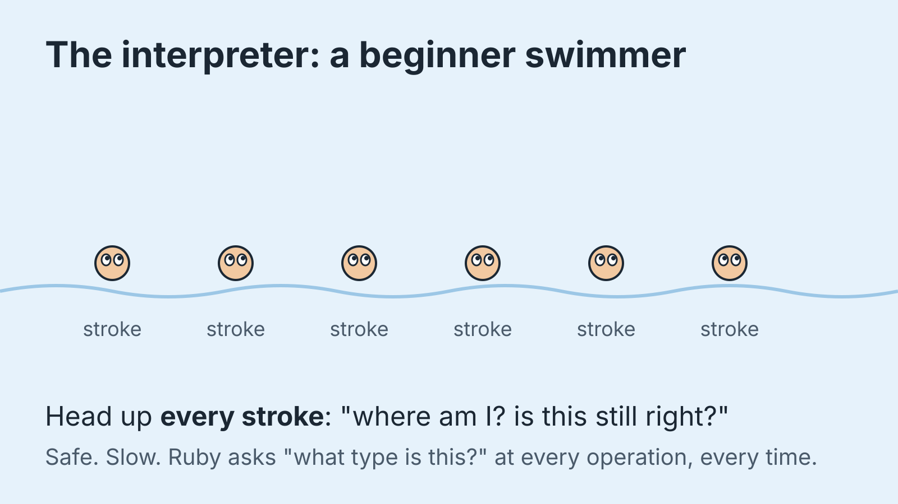
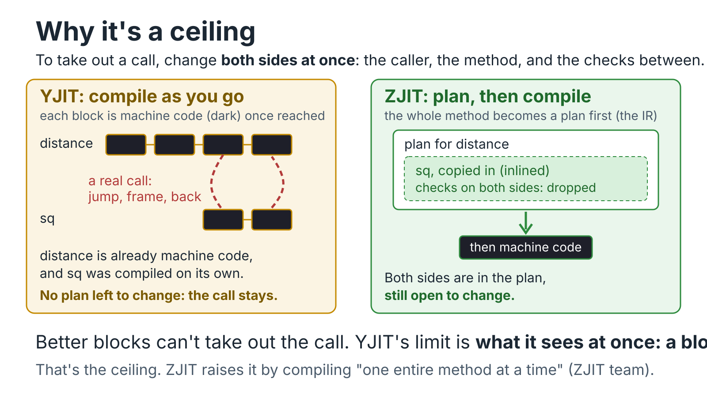
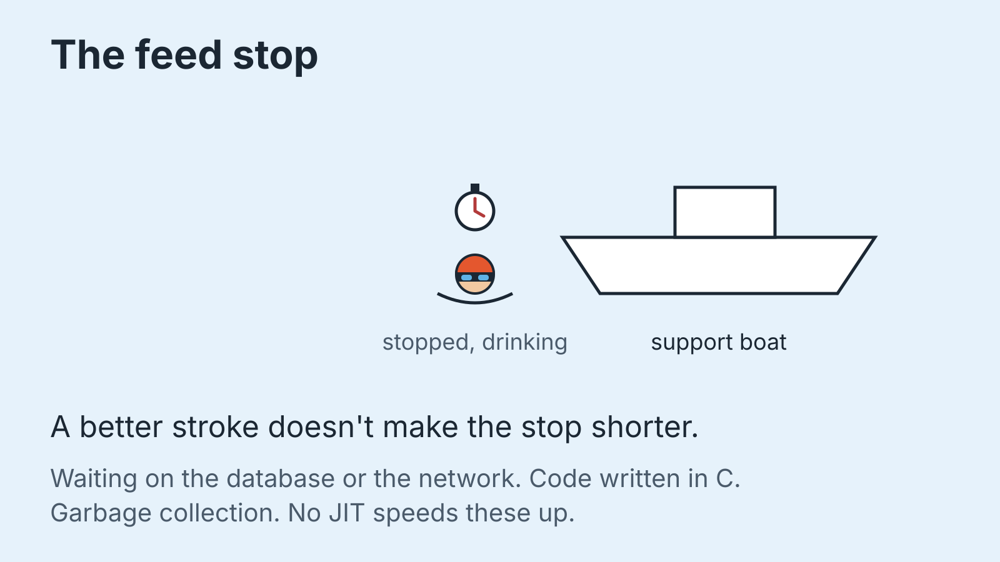

#+TITLE: The Ceiling: Why Ruby 4.0 Needed a Second Compiler
#+AUTHOR: Dhruva Sagar
#+DATE: RubyConf 2026
#+OPTIONS: toc:nil num:nil timestamp:nil reveal_width:1600 reveal_height:900
#+STARTUP: overview
#+PROPERTY: header-args :eval never-export :exports code
#+PROPERTY: header-args:sh :dir (progn (defvar ceiling--tangling nil) (unless ceiling--tangling (let ((ceiling--tangling t)) (save-excursion (org-babel-tangle)))) "../src") :results output verbatim :prologue "export PATH=\"$HOME/.asdf/shims:$PATH\""
#+PROPERTY: header-args:ruby :dir (progn (defvar ceiling--tangling nil) (unless ceiling--tangling (let ((ceiling--tangling t)) (save-excursion (org-babel-tangle)))) "../src") :noweb yes :results output :ruby "$HOME/.asdf/shims/ruby"

# How this file works
# - Each top-level heading is a slide; :DURATION: is its time budget.
#   Speaker notes are in #+begin_notes (reveal speaker view: press "s").
# - Ruby on the slides lives in NAMED blocks. The Demo section assembles
#   them with noweb and tangles them into ../src/, so the code on a slide
#   IS the code that ran. Never edit ../src/ by hand.
# - Any sh/ruby block re-tangles before it runs (the :dir expression), and
#   runs in ../src/ under the Ruby pinned in ../.tool-versions, via asdf's
#   shims (Emacs's own PATH doesn't matter). Nothing runs on export.
# - Every listing on a slide is cut from ../captures/ (made by
#   ../bin/capture) and is checked line by line by ../bin/check. The
#   comment "# capture: FILE" above a listing names its source.

#+REVEAL_ROOT: https://cdn.jsdelivr.net/npm/reveal.js@4.6.1
#+REVEAL_VERSION: 4
#+REVEAL_PLUGINS: (highlight notes search zoom)
#+REVEAL_HIGHLIGHT_CSS: https://cdnjs.cloudflare.com/ajax/libs/highlight.js/11.9.0/styles/atom-one-dark.min.css
#+REVEAL_THEME: white
#+REVEAL_TRANS: none
#+REVEAL_MARGIN: 0.04
#+REVEAL_INIT_OPTIONS: slideNumber: true, hash: true
#+REVEAL_HEAD_PREAMBLE: 
#+REVEAL_TITLE_SLIDE: <h1>%t</h1>
%a · %d

Ruby 4.0 ships two JIT compilers. Why build the second one?

* Timing plan                                                      :noexport:

The spine is technical: one method through both compilers, a tie, then
one extra call that only one of them can see through, and why. My
swimming is texture, not the plot: long-distance swimming is about
efficiency, not power, and so is a JIT. It shows up only where it makes
an idea easier to hold.

| Slide                              | Budget |
|------------------------------------+--------|
| Every time you lift your head      |   1:00 |
| Ruby swims with its head up        |   0:30 |
| Our five lines                     |   0:30 |
| The bytecode                       |   0:45 |
| Learning to sight                  |   0:45 |
| YJIT: compile as you go            |   1:00 |
| ZJIT: watch, then plan             |   0:45 |
| ZJIT: the IR on one slide          |   1:00 |
| 25 compiles, or one                |   0:30 |
| On five lines, a tie               |   0:45 |
| The plateau                        |   1:00 |
| Why it's a ceiling                 |   1:15 |
| One more call                      |   0:30 |
| One more call is one more buoy     |   0:30 |
| At the turn buoy                   |   1:30 |
| The 2-beat kick                    |   0:30 |
| In the ZJIT team's words           |   0:45 |
| Race day: params                   |   0:30 |
| params, through both               |   1:00 |
| The feed stop                      |   0:30 |
| Calm water, choppy water           |   1:00 |
| Read your own code                 |   0:45 |
| What it means for Ruby             |   0:45 |
| Head down                          |   0:45 |
|------------------------------------+--------|
| total                              |  18:30 |

1:30 of slack. Cut order if long: (1) "25 compiles, or one"; (2) "The
2-beat kick" (say its one line on the quote slide). Never cut "On five
lines, a tie", "Why it's a ceiling" or "At the turn buoy": they are the
argument.

The [STORY: …] lines are mine to fill, in my own words. Everything in
square brackets in the notes is stage direction or depth-if-asked, not
spoken.

* Every time you lift your head
:PROPERTIES:
:DURATION: 1:00
:END:

/"Every time you lift your head, you slow down."/

Ruby 4.0 ships *two* just-in-time compilers. Why build the second one?

#+begin_notes
[STORY: learning long-distance open water. Suggested shape: "When I started
swimming long distance I tried to go faster by pulling harder. I burned
out. My coach said: every time you lift your head, you slow down. Long
distance isn't about power. It's about not wasting any."]

That turns out to be how compilers make Ruby fast too: not by doing each
step harder, but by wasting less.

Ruby 4.0 came out last Christmas with two just-in-time compilers. YJIT has
made real Rails apps faster for years. ZJIT is new, from the same team.
Why build a second one? Let's follow one five-line method through both.

[Bio, one line: fifteen years of Ruby; I write Rust, which both are
written in.]
#+end_notes

* Ruby swims with its head up
:PROPERTIES:
:DURATION: 0:30
:REVEAL_EXTRA_ATTR: class="diagram"
:END:

#+attr_html: :alt The beginner swimmer lifts their head every stroke

#+begin_notes
A beginner lifts their head every stroke: where am I, is this still right?
Safe, and slow.

Ruby's interpreter runs your code a lot like that. Let me show you.
#+end_notes

* Our five lines
:PROPERTIES:
:DURATION: 0:30
:END:

#+name: point-class
#+begin_src ruby
class Point
  attr_reader :x, :y
  def initialize(x, y) = (@x, @y = x, y)
end
#+end_src

#+name: distance-v1
#+begin_src ruby
def distance(a, b)
  dx = a.x - b.x
  dy = a.y - b.y
  Math.sqrt(dx * dx + dy * dy)
end
#+end_src

#+begin_notes
Here's the method we'll follow all talk: the distance between two points.

Before any JIT touches it, Ruby turns it into bytecode, and the
interpreter runs that.
#+end_notes

* The bytecode
:PROPERTIES:
:DURATION: 0:45
:END:

# LIVE: C-c C-c on stage. Instant, the same every run. Fallback below.
#+begin_src sh
ruby -r ./distance -e 'puts RubyVM::InstructionSequence.of(method(:distance)).disasm'
#+end_src

# capture: yarv-distance.txt
#+begin_example
0000 getlocal_WC_0          a@0
0002 opt_send_without_block <calldata!mid:x, argc:0, ARGS_SIMPLE>
0004 getlocal_WC_0          b@1
0006 opt_send_without_block <calldata!mid:x, argc:0, ARGS_SIMPLE>
0008 opt_minus              <calldata!mid:-, argc:1, ARGS_SIMPLE>
0010 setlocal_WC_0          dx@2
 ...
0040 opt_send_without_block <calldata!mid:sqrt, argc:1, ARGS_SIMPLE>
0042 leave
#+end_example

#+attr_html: :class ver
Ruby 4.1.0-preview1

#+begin_notes
[Run the live block.]

Top to bottom: get a, call x on it. Get b, call x on it. Minus. Store it
in dx.

That "minus" doesn't know it's subtracting numbers. It could be anything
with a minus method. So every time it runs, the interpreter lifts its head
and checks. You can run this line on your own code tonight.
#+end_notes

* Learning to sight
:PROPERTIES:
:DURATION: 0:45
:REVEAL_EXTRA_ATTR: class="diagram"
:END:

#+attr_html: :alt A trained swimmer looks once, then keeps their head down
[[file:img/sighting.svg]]

#+begin_notes
[STORY, one or two lines: learning to sight. You still have to look, or
you swim the wrong way. The skill is looking less, and only when it
counts.]

A just-in-time compiler does that for your busiest code. It looks once,
a quick check called a guard, "is this still a number?", then runs fast
machine code. If the check fails, it falls back to the careful way.

Ruby has two of them, and they look in different ways.
#+end_notes

* YJIT: compile as you go
:PROPERTIES:
:DURATION: 1:00
:END:

- Once a method is warm, compile a small piece, run it
- Look at the values that really turned up
- Compile the next piece for exactly those

# capture: yjit-distance.txt
#+begin_example
# Insn: 0002 opt_send_without_block (stack_size: 1)
# call to Point#x
# guard not immediate
# guard known class
# guard shape
# Block: distance@distance.rb:7
# Insn: 0004 getlocal_WC_0 (stack_size: 1)
# defer_compilation
#+end_example

#+attr_html: :class ver
Ruby 4.1.0-preview1 · =ruby --yjit --yjit-dump-disasm=

#+begin_notes
YJIT compiles as it goes. This is its own commentary, machine code taken
out.

At a.x it checks: a real object, a Point, laid out as before. Then it
reads @x directly.

"defer_compilation" means: stop here, let the code run, and compile the
next piece when we get there, for whatever value is really there. Very
little wasted work, and it's why YJIT paid off so fast.

[Depth: lazy basic block versioning. "Shape" is an object's
instance-variable layout.]
#+end_notes

* ZJIT: watch, then plan
:PROPERTIES:
:DURATION: 0:45
:END:

- While the interpreter runs the method, record which types turn up: a *profile*
- Then turn the *whole method* into a plan: the *IR*
- Improve the plan, then compile it, once

#+begin_notes
ZJIT does it the other way round. While the interpreter runs your method,
it keeps notes on which types showed up. That's a profile.

Then it turns the whole method into a plan, its intermediate
representation, improves the plan, and compiles it in one go.
#+end_notes

* ZJIT: the IR on one slide
:PROPERTIES:
:DURATION: 1:00
:END:

# capture: zjit-distance.txt
#+begin_example
fn distance@distance.rb:7:
bb3(v15:BasicObject, v16:BasicObject, v17:BasicObject):
  v79:ObjectSubclass[class_exact:Point] = GuardType v16
  v82:CShape[0x10007a] = GuardBitEquals v81, CShape(0x10007a) recompile
  v83:BasicObject = LoadField v79, :@x
  ...
  v93:Fixnum = GuardType v83, Fixnum recompile
  v94:Fixnum = GuardType v90, Fixnum
  v95:Fixnum = FixnumSub v93, v94
  ...
  v118:Fixnum = FixnumMult v95, v95
  ...
  v130:BasicObject = CCallWithFrame v54, :Math.sqrt, v126
  Return v130
#+end_example

#+attr_html: :class cap
The whole method as one plan. =GuardType= and =GuardBitEquals= are sights. =v95= is =dx=.

#+attr_html: :class ver
Ruby 4.1.0-preview1 · =ruby --zjit --zjit-dump-hir=

#+begin_notes
This is ZJIT's plan for our five lines. The whole method fits on one
slide.

Every value gets a name, set exactly once. v16 is a. GuardType: is it a
Point? GuardBitEquals: laid out as expected? The same checks YJIT made.

FixnumSub makes dx, named v95. Then dx times dx: FixnumMult v95, v95. And
CCallWithFrame calls into C for Math.sqrt. No compiler sees inside C.

[Depth: "set once" is SSA. Trimmed: PatchPoints, which discard this code
if someone redefines Point#x.]
#+end_notes

* 25 compiles, or one
:PROPERTIES:
:DURATION: 0:30
:END:

# capture: how-yjit.txt, how-zjit.txt
#+begin_example
YJIT                                          ZJIT
call 30                                       call 30
distance@distance_log.rb:7 (index: 0)         distance@distance_log.rb:7
distance@distance_log.rb:7 (index: 2)
 ...
distance@distance_log.rb:10 (index: 42)
#+end_example

#+attr_html: :class cap
Default settings. Both start at call 30. YJIT: *25* pieces. ZJIT: *1* plan.

#+begin_notes
You can count it. Both wait until call 30. Then YJIT compiles twenty-five
pieces of this method; ZJIT compiles one plan.
#+end_notes

* On five lines, a tie
:PROPERTIES:
:DURATION: 0:45
:END:

# capture: yjit-distance.txt, zjit-distance.txt
#+begin_example
YJIT                                         ZJIT
# Insn: 0028 getlocal_WC_0 (stack_size: 2)   v95:Fixnum = FixnumSub v93, v94
# Insn: 0030 opt_mult (stack_size: 3)        ...
# Insn: 0032 getlocal_WC_0 (stack_size: 2)   v118:Fixnum = FixnumMult v95, v95
#+end_example

#+attr_html: :class cap
At =dx * dx= neither checks again: both already know =dx= is a number.

#+attr_html: :class ver
Ruby 4.1.0-preview1 · default settings

#+begin_notes
So who wins on our five lines? Honestly: nobody.

At dx times dx, YJIT doesn't check again. It carried "dx is a number"
forward from the minus. ZJIT doesn't either. Same checks, same work.

On straight-line code like this, YJIT already got the wins. To see why
ZJIT exists, we need something every Ruby codebase is full of.
#+end_notes

* The plateau
:PROPERTIES:
:DURATION: 1:00
:REVEAL_EXTRA_ATTR: class="diagram"
:END:

#+attr_html: :alt Swim times drop fast while learning to sight, then stop moving
[[file:img/plateau.svg]]

#+begin_notes
[STORY: the plateau. Suggested: "Sighting made me faster every week. Then
it stopped. When I looked at where the time went, the straight legs were
fine. I was losing it at the turns." Keep only what's true for you.]

YJIT hit the same kind of wall. The easy wins are taken. What's left is at
the turns, and in Ruby the turns are method calls. We write small methods
calling small methods. That's how we're taught.
#+end_notes

* Why it's a ceiling
:PROPERTIES:
:DURATION: 1:15
:REVEAL_EXTRA_ATTR: class="diagram"
:END:

#+attr_html: :alt YJIT compiles pieces as it goes; ZJIT builds one plan for the whole method and can rewrite it

#+begin_notes
Why can't YJIT just get faster at calls? Because of its shape.

YJIT turns each piece into machine code as soon as it reaches it. There's
never a picture of the whole method, so there's nothing to rearrange
afterwards. A call to another method stays a real call.

ZJIT builds the whole method as a plan first. And a plan can be rewritten
before it runs: splice a small method in, drop a check that's already been
done.

That's the ceiling. The ZJIT team put it exactly this way: instead of one
piece at a time, one entire method at a time, which gives the optimizer
more code to work with.

[Sources: Bernstein, Rails at Scale, 2025-05-14: "Instead of compiling one
basic block at a time, it compiles one entire method at a time"; "gives
more code at once to the optimizer".]
#+end_notes

* One more call
:PROPERTIES:
:DURATION: 0:30
:END:

#+name: distance-v2
#+begin_src ruby
def sq(n) = n * n

def distance(a, b)
  dx = a.x - b.x
  dy = a.y - b.y
  Math.sqrt(sq(dx) + sq(dy))
end
#+end_src

#+begin_notes
Let's add a turn. The smallest refactor you'd ever make: pull n times n
into a helper called sq.
#+end_notes

* One more call is one more buoy
:PROPERTIES:
:DURATION: 0:30
:REVEAL_EXTRA_ATTR: class="diagram"
:END:

#+attr_html: :alt One more call is one more turn buoy
[[file:img/turn-buoy.svg]]

#+begin_notes
YJIT reaches the turn and has to make the call: sq is separate machine
code.

ZJIT can see the whole course, turn included. It splices sq into
distance. That's called inlining.
#+end_notes

* At the turn buoy
:PROPERTIES:
:DURATION: 1:30
:END:

# capture: yjit-sq.txt, zjit-sq.txt
#+begin_example
YJIT                                     ZJIT
# call to Object#sq                      v95:Fixnum = FixnumSub v93, v94
# push callee control frame              ...
# gen_direct_jmp: existing block         PushInlineFrame :sq, v116, num_args=1
 ...                                     v169:Fixnum = FixnumMult v95, v95
# Block: sq@distance_sq.rb:6             PopInlineFrame
# Insn: 0004 opt_mult (stack_size: 2)
# guard arg0 fixnum
# guard arg1 fixnum
# pop stack frame
#+end_example

#+attr_html: :class cap
YJIT: a real call into a general =sq=. ZJIT: the call disappears; =sq= becomes one multiply of =v95=, which is =dx=.

#+attr_html: :class ver
Ruby 4.1.0-preview1 · default settings

#+begin_notes
Here's the turn, in each compiler's own words.

YJIT, left. sq is called twice per distance, so it got hot first and YJIT
compiled it on its own, for any caller. So distance makes a real call: a
new stack frame, a jump into that sq, and back. Since that sq serves
everyone, it checks n.

ZJIT, right. The call is gone. PushInlineFrame is just a note that sq is
"on the stack". What's left is FixnumMult v95, v95: dx times dx.

[Fair to YJIT, if asked: force it to compile early and it carries "n is a
number" into sq, so no check there. Its team says its design "allows for
easy interprocedural type-based specialization". The call stays.]
#+end_notes

* The 2-beat kick
:PROPERTIES:
:DURATION: 0:30
:REVEAL_EXTRA_ATTR: class="diagram"
:END:

#+attr_html: :alt The 2-beat kick is timed to the whole stroke
[[file:img/two-beat-kick.svg]]

#+begin_notes
[STORY, short: the 2-beat kick. "Fewer kicks, timed to the whole stroke.
I couldn't get there one kick at a time."]

Same with sq: you can only splice it in if you can see the caller and the
callee together.
#+end_notes

* In the ZJIT team's words
:PROPERTIES:
:DURATION: 0:45
:END:

#+begin_quote
"we want to both raise the performance ceiling (bigger compilation unit size and SSA IR) and encourage more outside contribution (by becoming a more traditional method compiler)."
--- Max Bernstein, ZJIT team, Rails at Scale, 2025-12-24
#+end_quote

#+begin_notes
Raise the ceiling: a bigger piece compiled at once, as a plan with every
value named once, which is what SSA means. And a traditional compiler
shape, so more people can help build it.

It isn't free. ZJIT plans from what it saw while warming up. If your
traffic changes after that, the plan is wrong and it has to fall back or
recompile. YJIT simply adds another piece.

[Sources: launch post 2025-12-24 ("if your method call patterns change
significantly after your code has been compiled, we will frequently
side-exit into the interpreter"); merge post 2025-05-14 ("a more
traditional “textbook” compiler so it is easy for the community to
contribute to").]
#+end_notes

* Race day: params
:PROPERTIES:
:DURATION: 0:30
:END:

# capture: hwia-source.txt
#+begin_example
def 
  super(convert_key(key))
end

def convert_key(key)
  Symbol === key ? key.name : key
end
#+end_example

#+attr_html: :class cap
=HashWithIndifferentAccess=: what Rails =params= is built on.

#+attr_html: :class ver
activesupport 8.1.4.1

#+begin_notes
Toy methods flatter compilers. Here's one you run right now:
HashWithIndifferentAccess, which Rails params are built on. Look up a key:
turn a symbol into a string, then a normal hash lookup. And look: a small
method calling a small method.
#+end_notes

* params, through both
:PROPERTIES:
:DURATION: 1:00
:END:

#+attr_html: :class cap
YJIT at =[]=:

# capture: hwia-yjit-disasm.txt
#+begin_example
# call to ActiveSupport::HashWithIndifferentAccess#convert_key
# push callee control frame
# gen_direct_jmp: existing block
#+end_example

#+attr_html: :class cap
ZJIT at =[]=:

# capture: hwia-zjit-hir.txt
#+begin_example
PushInlineFrame :convert_key, v27, num_args=1
v78:BoolExact = IsA v10, v43
CondBranch v50, bb8(), bb7()
 ...
PopInlineFrame
v35:BasicObject = CCallWithFrame v27, :Hash#[], v71
#+end_example

#+attr_html: :class ver
Ruby 4.1.0-preview1 · default settings

#+begin_notes
The same turn, in real code.

YJIT makes a real call into convert_key, just like sq.

ZJIT splices convert_key in. "Symbol triple-equals key" becomes a plain
type test and a branch. Then super is a direct call to Hash#[]. Which is
written in C.
#+end_notes

* The feed stop
:PROPERTIES:
:DURATION: 0:30
:REVEAL_EXTRA_ATTR: class="diagram"
:END:

#+attr_html: :alt A feed stop: a better stroke doesn't make it shorter

#+begin_notes
And that's the feed stop. Hashing the key and finding it happens in C, and
no Ruby compiler makes C faster. Same for waiting on the database, and for
garbage collection. A better stroke doesn't shorten the stop at the boat.
#+end_notes

* Calm water, choppy water
:PROPERTIES:
:DURATION: 1:00
:END:

#+begin_src ruby :eval never
def double(x) = x + x   # called with Integers only, or with five types
#+end_src

#+attr_html: :class cap
Calm, ZJIT: spliced in, one check, one add.

# capture: zjit-calm.txt
#+begin_example
v44:Fixnum = GuardType v10, Fixnum recompile
v46:Fixnum = FixnumAdd v44, v44
#+end_example

#+attr_html: :class cap
Choppy: five types.

# capture: yjit-choppy.txt, zjit-choppy.txt
#+begin_example
YJIT                        ZJIT
# guard arg0 fixnum         CondBranchHasType v10, Fixnum, bb12(), bb13()
# call to Float#+           v79:BasicObject = CCallWithFrame v47, :Integer#+, v10
# call to String#+          ...
# call to Array#+           Send v10, :+, v10 # SendFallbackReason: Send: polymorphic fallback
#+end_example

#+attr_html: :class ver
Ruby 4.1.0-preview1 · default settings

#+begin_notes
Now the honest part: where ZJIT gives up.

Calm water, only whole numbers: ZJIT splices double in, one check, one add.

Choppy: five types. ZJIT plans for all of them, and every case becomes a
call into C, even whole numbers. YJIT, reacting as it goes, keeps a fast
add for whole numbers and adds a piece per type. In chop, adapting beats
planning.

[Depth: neither bailed out to the interpreter, 0 side exits each
(captures zjit-choppy-stats, yjit-choppy-stats).]
#+end_notes

* Read your own code
:PROPERTIES:
:DURATION: 0:45
:END:

#+begin_src sh :eval never
ruby -r ./your_file -e 'puts RubyVM::InstructionSequence.of(method(:m)).disasm'
ruby --zjit --zjit-dump-hir   your_file.rb
ruby --zjit --zjit-stats      your_file.rb
#+end_src

Look for:
1. A call that didn't disappear: a turn you could make easier
2. Checks you didn't expect: a value that isn't one type
3. Calls into C: time no Ruby compiler can touch

#+begin_notes
Three commands: the bytecode, ZJIT's plan, ZJIT's statistics.

In the plan, look for three things. Calls that are still calls. Checks on
values you thought were always one type. And calls into C, where the time
is out of the compiler's reach.
#+end_notes

* What it means for Ruby
:PROPERTIES:
:DURATION: 0:45
:END:

YJIT compiles Ruby a bit at a time, deciding as it goes; ZJIT plans a
whole method at once, so it can see through small method calls and stop
paying for them. That's the room Ruby needed to keep getting faster.

#+begin_notes
The 4.0 release notes call ZJIT "the next generation of YJIT", and set the
goal "faster than YJIT and production-ready in Ruby 4.1". In October the
team wrote that it's "probably as fast as or faster than YJIT" on
Shopify's storefront. 4.1 ships in a few weeks. Try it with --zjit.

[Sources: Ruby 4.0.0 release notes, 2025-12-25; Rails at Scale,
2026-10-09, measured in "a couple small regions".]
#+end_notes

* Head down
:PROPERTIES:
:DURATION: 0:45
:END:

/"Every time you lift your head, you slow down."/

Next time someone says "Ruby is slow", ask: *which part?*

Slides, code, every capture, the full write-up: *[REPO-URL]*

#+begin_notes
[STORY: the closing swim. A recent swim or race where it came together:
efficient, sighting only when it counted, through the turns without
stopping. Two or three sentences.]

Ruby is learning the same thing: waste less, look up less, and swim
through the turns.

Next time someone says "Ruby is slow", ask "which part?", and now you can
show them. Thank you.
#+end_notes

* Demo                                                             :noexport:

** Files

The program behind the first half of the talk.

#+begin_src ruby :tangle ../src/distance.rb :mkdirp yes
<<point-class>>

<<distance-v1>>

<<warmup>>
#+end_src

The same program after the one-line refactor ("One more call").

#+begin_src ruby :tangle ../src/distance_sq.rb :mkdirp yes
<<point-class>>

<<distance-v2>>

<<warmup>>
#+end_src

Enough calls that both JITs compile =distance= at their default settings
(30 calls each); 1,000 clears that comfortably.

#+name: warmup
#+begin_src ruby :eval never
a = Point.new(3, 4)
b = Point.new(0, 0)
1_000.times { distance(a, b) }
#+end_src

"How each one compiles": call =distance= 40 times, saying which call we are
on, so each JIT's compile log lands next to the call that triggered it.
Default thresholds, nothing forced.

#+begin_src ruby :tangle ../src/distance_log.rb :mkdirp yes
<<point-class>>

<<distance-v1>>

$stdout.sync = true
a = Point.new(3, 4)
b = Point.new(0, 0)
1.upto(40) do |i|
  puts "call #{i}"
  distance(a, b)
end
#+end_src

"Where it gives up": the same tiny method, warmed up in calm water
(only Integers) or in chop (five different types from the first call).

#+name: double
#+begin_src ruby :eval never
def double(x) = x + x
#+end_src

#+begin_src ruby :tangle ../src/calm.rb :mkdirp yes
<<double>>

1_000.times { [1, 2, 3, 4, 5].each { double(_1) } }
#+end_src

#+begin_src ruby :tangle ../src/choppy.rb :mkdirp yes
<<double>>

1_000.times { [1, 2.5, "ab", [1], 3r].each { double(_1) } }
#+end_src

=params=-shaped traffic: string keys stored, asked for with both a Symbol
and a String, so =convert_key= sees two types.

#+begin_src ruby :tangle ../src/hwia.rb :mkdirp yes
require "active_support"
require "active_support/hash_with_indifferent_access"

params = ActiveSupport::HashWithIndifferentAccess.new("id" => 1, "name" => "x")
100_000.times do
  params[:id]
  params["name"]
end
#+end_src

Print the real source of the two methods on the HWIA slide, from the
installed gem.

#+begin_src ruby :tangle ../src/hwia_source.rb :mkdirp yes
require "active_support"
require "active_support/hash_with_indifferent_access"

hwia = ActiveSupport::HashWithIndifferentAccess
puts "activesupport #{ActiveSupport.version}"
%i[[] convert_key].each do |name|
  file, line = hwia.instance_method(name).source_location
  src = File.readlines(file)[(line - 1)..]
  puts "", "# #{File.basename(file)}:#{line}", src.take(src.index { _1 =~ /^\s*end\b/ } + 1)
end
#+end_src

** Captures

Each capture is one =bin/capture= target; it writes ../captures/NAME.txt
(paths and memory addresses scrubbed) and prints it. Re-run them all from a
shell with =bin/capture=, then =bin/check=.

#+name: cap-env
#+begin_src sh
../bin/capture env
#+end_src

#+name: cap-how
#+begin_src sh
../bin/capture how-yjit how-zjit >/dev/null
echo "YJIT compile events for distance: $(grep -c 'distance@' ../captures/how-yjit.txt)"
echo "ZJIT compile events for distance: $(grep -c 'distance@' ../captures/how-zjit.txt)"
#+end_src

#+name: cap-yjit-sq
#+begin_src sh
../bin/capture yjit-sq >/dev/null
grep -nE '# (call to Object#sq|Block: sq|guard arg|push callee|pop stack|clear local)' ../captures/yjit-sq.txt | head -20
#+end_src

#+name: cap-zjit-sq
#+begin_src sh
../bin/capture zjit-sq >/dev/null
awk '/^fn distance@/{p=1} p&&/^$/{exit} p' ../captures/zjit-sq.txt
#+end_src
